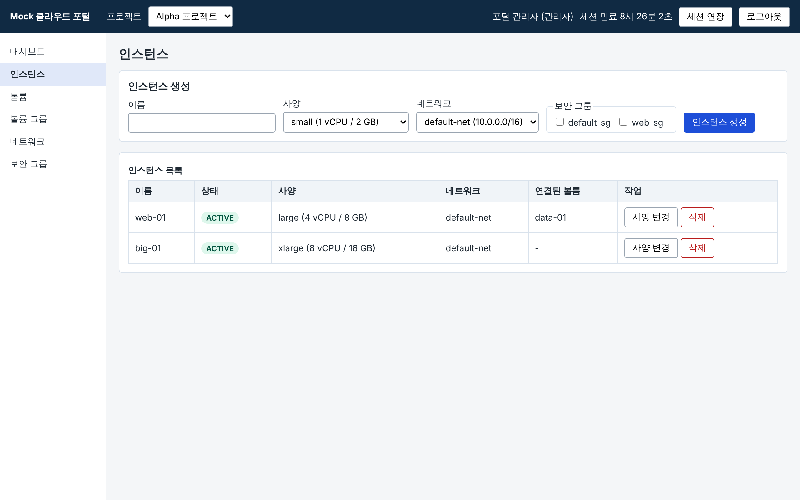

# Mock 클라우드 포털 QA 자동화 포트폴리오

작은 **Mock 클라우드 포털**(웹 콘솔 + REST API)을 직접 만들고, 그 위에 Playwright 기반 UI/API 테스트 자동화, 테스트 하네스(실행 → 증적 수집 → 결과서 자동 작성), GitHub Actions CI를 적용하는 저장소입니다.

> 이 저장소의 포털, 리소스, TC ID, 계정은 모두 가상입니다. 실제 회사·제품 정보는 들어 있지 않습니다.

## 진행 상태

단계별로 개발하고 있습니다. 완료한 단계만 체크합니다.

- [x] 0단계: 프로젝트 뼈대(TypeScript, ESLint, AI 작업 지침)
- [x] 1단계: Mock 포털 REST API
- [x] 2단계: 웹 콘솔 화면
- [x] 3단계: REST API 자동화(상태 폴링, 남은 리소스 일괄 삭제)
- [x] 4단계: Playwright UI E2E(Page Object Model)
- [x] 5단계: 네거티브 dataset 테스트
- [ ] 6단계: 결함 주입과 결함 재현 테스트
- [ ] 7단계: Flaky 재현과 안정화(naive / stable 비교)
- [ ] 8단계: 실패 증적 수집과 실패 원인 자동 분류
- [ ] 9단계: 테스트 하네스와 Excel·PPT 결과서
- [ ] 10단계: CI 가드레일(판정 완화 변경 차단)
- [ ] 11단계: GitHub Actions 워크플로
- [ ] 12단계: 시연 시나리오와 이력서 대응표 정리

## 지금 실행할 수 있는 것

Node.js 20 이상이 필요합니다.

```bash
npm ci
npm run lint
npm run typecheck
npm run portal
npx playwright install chromium
npm test
npm run report
```

| 명령 | 하는 일 |
|---|---|
| `npm run portal` | Mock 포털만 띄운다 |
| `npm test` | 포털을 자동으로 띄운 뒤 전체 테스트를 실행한다 |
| `npm run test:api` | REST API 테스트만 실행한다 |
| `npm run test:ui` | UI E2E 테스트만 실행한다 |
| `npm run test:negative` | 네거티브 dataset 테스트만 실행한다 |
| `npm run test:negative:high` | 네거티브 dataset 중 결함이 자주 나는 영역(`risk: high`)만 실행한다 |
| `npm run report` | Playwright HTML 리포트를 연다 |

`npm run portal`을 실행하면 `http://127.0.0.1:4173`에서 웹 콘솔이, `http://127.0.0.1:4173/api`에서 REST API가 뜹니다.

## Mock 포털 웹 콘솔



빌드 과정이 없는 정적 HTML과 바닐라 JS로 만들었습니다. 모든 입력란에 label을 붙이고 버튼에 접근 가능한 이름을 줘서, 테스트가 `getByRole`·`getByLabel`만으로 요소를 찾을 수 있습니다.

| 화면 | 할 수 있는 일 |
|---|---|
| 로그인 | 아이디·비밀번호로 로그인한다. 실패하면 오류 메시지를 보여준다. |
| 상단 바 | 작업할 프로젝트를 고르고, 세션 만료 시각을 확인하고, 세션을 연장하거나 로그아웃한다. |
| 대시보드 | 프로젝트의 사용량과 쿼터를 표로 보여준다. 관리자는 쿼터를 바꿀 수 있다. |
| 인스턴스 | 인스턴스를 만들고, 사양을 바꾸고, 삭제한다. 연결된 볼륨도 함께 보여준다. |
| 볼륨 | 볼륨을 만들고, 인스턴스에 연결·분리하고, 삭제한다. |
| 볼륨 그룹 | 볼륨 여러 개를 묶어 그룹을 만들고 삭제한다. |
| 네트워크 | 네트워크와 서브넷(IP 대역)을 만들고 삭제한다. 일반 사용자에게는 생성·삭제 기능을 보여주지 않는다. |
| 보안 그룹 | 보안 그룹과 규칙을 만들고 삭제한다. |

화면 동작에서 테스트가 알아야 할 점은 다음과 같습니다.

- 목록은 1초마다 자동으로 갱신되어, `CREATING`이 `ACTIVE`로 바뀌는 과정이 화면에 그대로 보입니다.
- 메뉴를 누르면 해당 화면을 처음부터 다시 그리고 최신 데이터를 불러옵니다.
- 쿼터를 넘는 생성 요청은 화면에서 먼저 막고 오류 메시지를 보여줍니다(서버도 같은 요청을 `409`로 거부합니다).
- 삭제, 사양 변경, 볼륨 연결, 서브넷 추가는 대화상자에서 확인한 뒤 요청합니다. 요청이 거부되면 대화상자 안에 오류를 보여주고 닫지 않습니다.
- 세션이 만료되면 로그인 화면으로 돌아가고 만료 안내 메시지를 보여줍니다.

## Mock 포털 REST API

데이터는 메모리에만 저장하고, 서버를 다시 띄우거나 리셋 API를 부르면 초기 상태로 돌아갑니다.

### 가상 계정과 프로젝트

| 계정 | 비밀번호 | 권한 | 접근할 수 있는 프로젝트 |
|---|---|---|---|
| `admin` | `admin-pass` | 관리자 | `proj-alpha`, `proj-beta` |
| `member` | `member-pass` | 일반 사용자 | `proj-alpha` |

- 로그인하면 토큰을 응답 본문과 `portal_token` 쿠키로 함께 받습니다. API를 부를 때는 `Authorization: Bearer <토큰>` 헤더를 씁니다.
- 작업할 프로젝트는 `X-Project-Id` 헤더로 고릅니다. 헤더가 없으면 사용자의 첫 번째 프로젝트를 씁니다.
- 쿼터 변경과 네트워크·서브넷 생성·삭제는 관리자만 할 수 있습니다.

### 엔드포인트

| 분류 | 엔드포인트 |
|---|---|
| 인증 | `POST /auth/login`, `POST /auth/extend`, `POST /auth/logout`, `GET /auth/me` |
| 환경 | `GET /environments`, `GET /projects`, `GET /flavors` |
| 인스턴스 | `GET·POST /instances`, `GET·DELETE /instances/:id`, `POST /instances/:id/resize` |
| 볼륨 | `GET·POST /volumes`, `GET·DELETE /volumes/:id`, `POST /volumes/:id/attach`, `POST /volumes/:id/detach` |
| 볼륨 그룹 | `GET·POST /volume-groups`, `GET·DELETE /volume-groups/:id` |
| 네트워크·서브넷 | `GET·POST /networks`, `GET·DELETE /networks/:id`, `GET·POST /networks/:id/subnets`, `DELETE /networks/:id/subnets/:subnetId` |
| 보안 그룹 | `GET·POST /security-groups`, `GET·DELETE /security-groups/:id` |
| 쿼터·사용량 | `GET·PUT /quota`, `GET /usage` |
| 테스트용 | `POST /test/reset`, `GET /test/flags` |

### 상태 전이

생성·삭제·사양 변경 요청은 바로 끝나지 않습니다. 요청은 '접수'만 하고, 실제 작업은 지연 시간(`TRANSITION_DELAY_MS`) 뒤에 끝납니다. 그래서 테스트는 응답 코드가 아니라 리소스 상태를 폴링해서 완료를 판정해야 합니다.

| 리소스 | 상태 전이 |
|---|---|
| 인스턴스 | `CREATING` → `ACTIVE` 또는 `ERROR`(서브넷이 없는 네트워크에 만들면 IP를 할당하지 못해 `ERROR`), `ACTIVE` → `RESIZING` → `ACTIVE`, `DELETING` → 목록에서 사라짐 |
| 볼륨 | `CREATING` → `AVAILABLE`, `ATTACHING` → `IN_USE`, `DETACHING` → `AVAILABLE`, `DELETING` → 목록에서 사라짐 |
| 볼륨 그룹 | `CREATING` → `AVAILABLE`, `DELETING` → 목록에서 사라짐 |

### 입력 규칙과 오류 응답

오류 응답은 `{ "error": { "code", "message", "field" } }` 형식으로 통일했습니다.

| 규칙 | 위반했을 때 |
|---|---|
| 이름은 3~30자이고, 영문 소문자로 시작하며 영문 소문자·숫자·하이픈만 쓴다 | `400 INVALID_LENGTH`, `400 INVALID_FORMAT` |
| 필수값을 빠뜨리면 안 된다 | `400 REQUIRED` |
| 볼륨 크기는 1~1000 GB | `400 OUT_OF_RANGE` |
| 서브넷 IP 대역은 네트워크 대역 안에 있어야 하고 다른 서브넷과 겹치면 안 된다 | `400 OUT_OF_RANGE`, `409 CIDR_OVERLAP` |
| 프로젝트 쿼터를 넘으면 안 된다 | `409 QUOTA_EXCEEDED` |
| 쓰이고 있는 리소스는 삭제할 수 없다(인스턴스가 쓰는 보안 그룹·네트워크, 볼륨 그룹에 속한 볼륨) | `400 RESOURCE_IN_USE` |
| 권한이 없는 작업이나 프로젝트에는 접근할 수 없다 | `403 FORBIDDEN` |
| 토큰이 없거나 만료되면 안 된다 | `401 UNAUTHENTICATED`, `401 TOKEN_EXPIRED` |

### 환경변수

| 환경변수 | 기본값 | 설명 |
|---|---|---|
| `PORTAL_PORT` | `4173` | 포털 포트 |
| `TRANSITION_DELAY_MS` | `1000` | 상태 전이에 걸리는 시간(ms) |
| `TOKEN_TTL_SEC` | `3600` | 토큰 유효 시간(초). 짧게 줄여 실행 중 세션 만료를 재현한다 |

## REST API 자동화

### 판정 기준: '요청 성공'이 아니라 '실제 작업 완료'

포털의 생성·삭제·사양 변경 API는 요청을 접수만 하고 2xx를 돌려줍니다. 그래서 응답 코드만 보고 통과시키면, 실제로는 작업이 끝나지 않았거나 실패했는데도 테스트가 통과합니다. 이 저장소의 API 자동화는 아래 순서로 판정합니다.

| 단계 | 하는 일 | 코드 |
|---|---|---|
| 1. 요청과 응답을 짝짓는다 | 모든 요청은 `{ request, status, body, error }`로 묶인 결과를 돌려주고, HTTP 응답 이력(2xx 포함)에 기록된다. | `src/api/client.ts` |
| 2. 상태를 폴링한다 | 목록 API에서 리소스가 목표 상태(`ACTIVE`, `AVAILABLE` 등)가 되거나 목록에서 사라질 때까지 반복 조회한다. 관측한 상태 변화는 폴링 이력에 남긴다. | `src/api/poll.ts`, `src/api/actions.ts` |
| 3. 실패 상태는 바로 실패 처리한다 | `ERROR`·`FAILED`가 보이면 제한 시간까지 기다리지 않고 원인과 함께 실패시킨다. | `waitForStatus`, `waitForGone` |
| 4. 응답만으로 알 수 없으면 다시 확인한다 | 삭제가 HTTP 400·404로 끝나면 목록 API로 실제 상태를 확인한다. 이미 없거나 `DELETING`이면 삭제가 진행된 것이고, 그대로 남아 있으면 거부된 것이다. | `deleteAndWait` |

### 남은 리소스 일괄 삭제

테스트가 만든 리소스는 이름이 `qa-`로 시작합니다. 테스트가 끝날 때마다 `cleanupLeftovers`(`src/api/cleanup.ts`)가 이 접두어가 붙은 리소스를 한 번에 삭제합니다.

- 의존 관계 때문에 볼륨 그룹 → 볼륨(연결돼 있으면 먼저 분리) → 인스턴스 → 보안 그룹 → 네트워크 순서로 지웁니다.
- 생성 중이거나 변경 중인 리소스는 진행이 끝난 뒤에 지웁니다.
- 하나가 실패해도 멈추지 않고 끝까지 진행한 뒤, 삭제에 실패한 항목을 보고합니다. 실패한 항목이 있으면 그 테스트를 실패로 처리합니다.

### 로그인과 세션

- 스위트(워커)당 한 번만 로그인하고 모든 테스트가 같은 세션을 씁니다(`src/fixtures/api.ts`).
- 요청이 401을 받으면 제품 실패로 보지 않고, 다시 로그인해서 같은 요청을 한 번 더 보냅니다. 이 과정은 HTTP 응답 이력에 그대로 남습니다.
- 테스트가 실패하면 HTTP 응답 이력과 상태 폴링 이력을 리포트에 첨부합니다.

### API 테스트 목록 (`tests/api`)

TC ID는 이 저장소에서 만든 가상 ID입니다.

| TC ID | 확인하는 내용 |
|---|---|
| API-ENV-001 | 로그인 없이 환경 목록을 조회하고, 로그인 후 프로젝트와 사양을 조회한다 |
| API-AUTH-001 | 일반 사용자는 자신이 속한 프로젝트만 조회한다 |
| API-AUTH-002 | 토큰 없이 요청하면 401로 거부한다 |
| API-AUTH-003 | 쓰던 토큰이 무효가 되면 다시 로그인해서 요청을 이어간다 |
| API-INST-001 | 생성 요청 후 `ACTIVE`가 될 때까지 확인하고, 삭제 후 목록에서 사라졌는지 확인한다 |
| API-INST-002 | 사양 변경 요청 후 `RESIZING`을 거쳐 `ACTIVE`가 되면 새 사양이 적용된다 |
| API-INST-003 | 인스턴스가 `ERROR`가 되면 제한 시간까지 기다리지 않고 바로 실패로 판정한다 |
| API-INST-004 | 진행 중인 인스턴스 삭제는 400으로 거부되고, 목록 API로 확인하면 그대로 남아 있다 |
| API-VOL-001 | 볼륨을 만들어 인스턴스에 연결하고, 분리한 뒤 삭제한다 |
| API-VOL-002 | 연결된 볼륨 삭제는 400으로 거부되고 볼륨은 그대로 남는다 |
| API-VG-001 | 볼륨 그룹을 만들고 `AVAILABLE`이 될 때까지 기다린 뒤, 삭제가 실제로 끝났는지 확인한다 |
| API-NET-001 | 네트워크와 서브넷을 만들고 조회한 뒤 삭제한다 |
| API-SG-001 | 규칙이 있는 보안 그룹을 만들고 삭제한다 |
| API-SG-002 | 인스턴스가 쓰는 보안 그룹 삭제는 400으로 거부되고, 목록 API로 확인하면 그대로 남아 있다 |
| API-USAGE-001 | 사용량 API의 값이 실제로 만든 리소스와 일치한다 |
| API-CLEAN-001 | 테스트가 남긴 리소스를 의존 순서대로 한 번에 삭제하고, 기본 리소스는 남긴다 |

## UI E2E 자동화

API 테스트만으로는 화면에서만 드러나는 결함(화면 표시가 실제 상태와 다름, 화면에서 막아야 할 입력을 막지 못함, 권한 없는 기능이 보임)을 잡을 수 없습니다. 그래서 같은 포털의 웹 콘솔을 Playwright로 자동화했습니다.

### 구조: Page Object Model

| 계층 | 담당 | 위치 |
|---|---|---|
| Page Object | 화면 요소를 찾는 locator와 클릭·입력 같은 action만 가진다. 기대값 확인은 하지 않는다. | `src/pages/` |
| Fixture | 로그인된 콘솔을 준비하고, 테스트가 끝나면 남은 리소스를 정리한다. | `src/fixtures/ui.ts` |
| 테스트 | 시나리오와 assertion만 표현한다. | `tests/ui/` |

- 화면 요소는 모두 `getByRole`, `getByLabel`, `getByText`로 찾습니다. CSS 선택자나 XPath는 쓰지 않습니다.
- 목록 화면의 공통 부분(표, 행 찾기, 생성 폼, 확인 대화상자)은 `ResourceListPage`에 모았고, 화면마다 다른 부분만 각 Page Object가 가집니다.
- 메뉴를 누른 직후에는 이전 화면이 잠깐 남아 있습니다. 그래서 `ConsolePage`는 새 화면의 제목이 나타난 뒤에 해당 Page Object를 돌려줍니다.
- 고정 시간 대기(`waitForTimeout`)는 쓰지 않습니다. 상태 변화는 `expect(locator).toHaveText('ACTIVE')`처럼 조건이 충족될 때까지 기다리는 assertion으로 확인합니다.

### 로그인과 리소스 준비

- 화면에서 매번 로그인하지 않습니다. 스위트당 한 번 API로 로그인해 받은 토큰을 브라우저 쿠키에 넣어 재사용합니다. 로그인 화면 자체는 `UI-AUTH-*` 테스트에서만 다룹니다.
- 테스트의 사전 조건이 되는 리소스(예: 사양 변경 대상 인스턴스)는 화면이 아니라 API로 만듭니다. 화면 조작은 그 테스트가 확인하려는 동작에만 씁니다.
- 화면에서 확인한 결과는 API로도 다시 확인합니다. 화면 표시와 실제 리소스 상태가 어긋나는 결함을 잡기 위해서입니다.

### UI 테스트 목록 (`tests/ui`)

| TC ID | 확인하는 내용 |
|---|---|
| UI-AUTH-001 | 올바른 계정으로 로그인하면 대시보드가 열리고 사용자 이름이 표시된다 |
| UI-AUTH-002 | 비밀번호가 틀리면 오류 메시지를 보여주고 로그인 화면에 머문다 |
| UI-AUTH-003 | 로그아웃하면 로그인 화면으로 돌아가고, 쓰던 토큰으로는 API를 호출할 수 없다 |
| UI-SESSION-001 | 세션 연장을 누르면 연장 안내가 나오고 이후에도 화면을 계속 쓸 수 있다 |
| UI-INST-001 | 화면에서 인스턴스를 만들면 `CREATING`을 거쳐 `ACTIVE`로 표시되고, API의 실제 상태와 일치한다 |
| UI-INST-002 | 화면에서 사양을 변경하면 화면에 표시된 사양이 API의 실제 사양과 일치한다 |
| UI-INST-003 | 화면에서 인스턴스를 삭제하면 `DELETING`을 거쳐 목록에서 사라지고, API 목록에도 없다 |
| UI-INST-004 | 같은 사양으로 변경하면 대화상자에 오류를 보여주고 인스턴스는 그대로 `ACTIVE`다 |
| UI-INST-005 | 인스턴스 목록에 연결된 볼륨 이름이 표시된다 |
| UI-VOL-001 | 화면에서 볼륨을 만들어 인스턴스에 연결하고 분리한다 |
| UI-VOL-002 | 화면에서 볼륨을 삭제하면 목록에서 사라지고, API 목록에도 없다 |
| UI-VG-001 | 화면에서 볼륨 그룹을 만들고 삭제하면, 그룹이 사라진 뒤 볼륨은 그룹에서 풀려난다 |
| UI-VG-002 | 볼륨 그룹에 속한 볼륨을 삭제하려 하면 대화상자에 오류를 보여주고 볼륨은 그대로 남는다 |
| UI-NET-001 | 화면에서 네트워크를 만들고 서브넷을 추가하면 목록에 IP 대역이 표시된다 |
| UI-NET-002 | 네트워크 대역을 벗어난 서브넷은 대화상자에 오류를 보여주고 추가되지 않는다 |
| UI-SG-001 | 화면에서 규칙이 있는 보안 그룹을 만들면 목록에 규칙이 표시된다 |
| UI-SG-002 | 인스턴스가 쓰는 보안 그룹을 삭제하려 하면 대화상자에 오류를 보여주고 보안 그룹은 그대로 남는다 |
| UI-DASH-001 | 대시보드의 사용량이 실제로 만든 리소스와 일치한다 |
| UI-QUOTA-001 | 쿼터를 넘는 인스턴스 생성은 화면에서 막고, API 목록에도 인스턴스가 생기지 않는다 |
| UI-QUOTA-002 | 관리자가 대시보드에서 쿼터를 바꾸면 표와 API에 반영된다 |
| UI-ROLE-001 | 일반 사용자에게는 쿼터 변경과 네트워크 생성·삭제 기능이 보이지 않고, 자신의 프로젝트만 고를 수 있다 |

## 네거티브 dataset 테스트

입력 규칙을 어긴 요청을 시스템이 제대로 거부하는지 확인하는 테스트입니다. 케이스를 코드가 아니라 JSON dataset으로 관리하고, 정상 흐름 테스트(`tests/api`, `tests/ui`)와 분리해 버전마다 같은 dataset을 반복 실행할 수 있게 했습니다.

### 구성

| 파일 | 내용 | 케이스 수 |
|---|---|---|
| `tests/negative/datasets/api-instance.json` | 인스턴스 이름 경계값·형식, 사양·네트워크 참조, 쿼터, 진행 중 상태의 작업 | 20 |
| `tests/negative/datasets/api-volume.json` | 볼륨 크기 경계값·형식, 용량 쿼터, 연결·삭제 상태, 볼륨 그룹 구성 | 14 |
| `tests/negative/datasets/api-network.json` | IP 대역 형식·prefix 범위·호스트 비트, 서브넷 범위·중복, 보안 그룹 규칙 | 12 |
| `tests/negative/datasets/api-auth.json` | 토큰 없음·무효·만료, 관리자 전용 기능, 다른 프로젝트 접근 | 10 |
| `tests/negative/datasets/ui-volume-form.json` | 볼륨 생성 화면의 이름·크기 입력과 쿼터 차단 | 9 |

케이스 하나는 아래 정보를 가집니다.

- `category`: 경계값(`boundary`), 필수값 누락(`required`), 형식(`format`), 참조(`reference`), 중복(`duplicate`), 쿼터 초과(`quota`), 상태(`state`), 권한 없음(`permission`), 인증(`auth`)
- `risk`: 결함이 자주 나는 영역이면 `high`입니다. 쿼터 초과, 진행 중 상태의 작업, 권한, 서브넷 대역처럼 화면에서는 막히지만 API로 직접 요청하면 뚫리기 쉬운 영역을 `high`로 골랐고, 고른 이유는 dataset 파일의 `riskReason`에 적었습니다. API dataset 56건 중 20건, 화면 dataset 9건 중 1건이 `high`입니다.
- `setup`: 사전 준비(인스턴스·볼륨·네트워크 생성, 볼륨 연결, 쿼터 임시 변경). 쿼터를 바꾼 케이스는 끝나면 원래 쿼터로 되돌립니다.
- `request`, `expect`: 보낼 요청과 기대하는 응답 코드·오류 코드·오류 필드
- `verify`: 응답을 받은 뒤 목록 API로 확인할 실제 상태

경계값은 실패하는 값만이 아니라 통과해야 하는 값(이름 3자·30자, 볼륨 1 GB·1000 GB)도 함께 넣어, 경계가 한쪽으로 밀린 결함도 잡을 수 있게 했습니다.

### 판정 절차

실행기(`tests/negative/api-negative.spec.ts`)는 케이스마다 같은 절차로 판정합니다.

1. 응답 코드, 오류 코드, 오류 필드가 기대와 같은지 확인합니다.
2. 응답만 믿지 않고 목록 API로 실제 상태를 확인합니다. 생성 요청이면 리소스가 생기지 않았는지, 변경·삭제 요청이면 대상이 그대로 남아 있는지 봅니다.
3. 거부된 요청이면 프로젝트 사용량과 쿼터가 요청 전과 같은지 확인합니다. 응답은 거부였는데 실제로는 리소스가 만들어져 사용량이 바뀌는 결함을 잡기 위해서입니다.

화면 dataset 실행기(`tests/negative/ui-negative.spec.ts`)는 화면에 기대한 오류 메시지가 표시되는지, 그리고 목록 API에 볼륨이 생기지 않았는지를 함께 확인합니다.

### 실행

```bash
npm run test:negative        # 전체 65건
npm run test:negative:high   # risk: high 21건만
npx playwright test --project=negative --grep @quota   # 분류별 실행(예: 쿼터)
```

케이스를 추가할 때는 dataset JSON에 항목만 추가하면 됩니다. 실행기가 테스트를 만들기 전에 dataset 형식(ID 형식과 중복, 필수 항목)을 검사하므로, 형식이 틀리면 바로 실패합니다.
