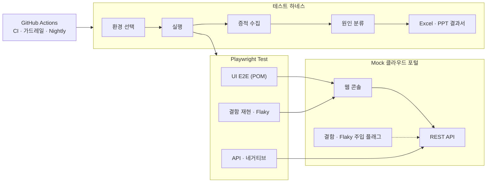

# Mock 클라우드 포털 QA 자동화 포트폴리오

[](https://github.com/hddhdd96/ui-auto/actions/workflows/ci.yml)

클라우드 플랫폼 QA에서 해 온 테스트 자동화를 **면접에서 직접 실행해 보여줄 수 있게** 재현한 저장소입니다.
가상 클라우드 포털(웹 콘솔 + REST API)을 직접 만들고, 그 위에 API·UI 자동화, 테스트 하네스, CI 가드레일을 올렸습니다.

> 포털·계정·TC ID는 모두 가상이고, 결함·Flaky 시나리오는 실무 사례를 **같은 원인 구조로 만든 가상 시나리오**입니다.
> 이 문서의 수치는 이 저장소에서 실제로 실행한 결과이며, 실무 수치는 '실무 성과' 열에만 따로 적었습니다.

## 한눈에 보기

| 영역 | 이 저장소에서 한 일 | 실행 결과 |
|---|---|---|
| API → UI 자동화 | 상태 폴링으로 '실제 작업 완료'를 판정하는 API 테스트, 화면 결과를 API로 다시 확인하는 UI E2E(POM) | API 16건, UI 21건 통과 |
| 네거티브 dataset | 경계값·필수값·쿼터·권한 규칙을 JSON dataset으로 관리, 결함 집중 영역만 따로 실행 | 65건 통과(집중 영역 21건) |
| 결함 재현 | 쿼터 초과 API 우회, 사양 변경 후 표시 사양 불일치를 결함 주입 플래그로 재현 | 결함 모드에서 기대한 테스트만 정확히 실패 |
| Flaky 안정화 | 4가지 원인 유형을 개선 전(naive)·후(stable) 테스트로 같은 조건에서 비교 | naive 실패율 40~80%, stable 25회 모두 통과 |
| 테스트 하네스 | 환경 선택 → 실행 → 증적 수집 → 실패 원인 분류 → Excel·PPT 결과서를 한 명령으로 | CI에서 111건부터 결과서까지 1분 26초 |
| CI 가드레일 | assert 삭제, retry·timeout 증가 같은 판정 완화 변경을 PR에서 차단 | 판정 완화 PR 병합 차단 확인([PR #8](https://github.com/hddhdd96/ui-auto/pull/8)) |

## 아키텍처



## 이력서 항목과 이 저장소의 대응

두 열의 수치는 서로 비교하는 값이 아닙니다. 실무 성과는 이력서 수치이고, 오른쪽은 이 저장소에서 같은 구조를 다시 만들어 실행한 결과입니다. (팀)은 팀 성과입니다.

| 이력서 항목 | 실무 성과(이력서 수치) | 이 저장소의 재현과 결과 |
|---|---|---|
| API → UI 순서로 자동화 확장 | API 29건 구현, UI 결함을 못 잡는 한계를 확인해 UI E2E 42건 도입 | API 16건 → UI 21건. 표시 사양 불일치는 API 테스트가 놓치고 UI 테스트만 잡음 |
| 테스트 하네스 | (팀) 제품별 회귀 1회 약 12시간 → 약 1시간, 현장 검증 투입 2명 → 1명, 일정 3일 → 1일 | 하네스 한 명령으로 실행부터 결과서까지. 전후 시간 비교는 하지 않음 |
| 결과서 증적 삽입 도구 | 1건당 약 15분 → 1분 이내 | 스크린샷을 Excel·PPT 결과서에 자동 삽입([예시](docs/samples/test-report-defect-mode.pptx)) |
| 환경 정보 API 조회 | 환경 설정 약 5분 → 30초 이내 | 하네스가 환경·프로젝트 목록을 API로 불러와 선택 |
| Flaky TC 안정화 | 18건(생성 10·삭제 8) × 5회 = 90회 모두 성공, 성공률 40% → 100% | 4가지 원인 유형 × naive·stable 각 5회: naive 실패율 40~80%, stable 0% |
| AI 판정 완화 방지 CI 규칙 | 규칙 12개 도입, 약 4개월 재발 없음 | 규칙 9개, 자기검증 25건, 실제 판정 완화 커밋 5건 모두 탐지 |
| 결함 집중 영역 네거티브 시나리오 | 33건 설계(IaaS 21·PaaS 12), 패치마다 수동 수행 | dataset 65건을 자동 반복 실행 |
| 환경 문제와 제품 결함 구분 | 현장 결함을 환경·설정 문제와 제품 결함으로 구분 | 실패를 product / test / env로 자동 분류: 정답 17건 중 16건 일치(94.1%) |
| VM 사양 불일치 원인 확인 | 화면·API 응답·실제 상태 비교로 원인 확인 | 사양 변경 후 표시 사양 불일치 결함을 재현하고 검출 |
| Canvas 콘솔 OCR 판정 | locator로 못 읽는 화면은 OCR로 판정 기준 작성 | **재현하지 않음**(Mock 콘솔은 일반 HTML) |

## 5분 데모

같은 결과를 매번 보여줄 수 있도록 Flaky 데모는 확률 100%, 시드 고정으로 실행합니다. 소요 시간은 개발 환경에서 실제로 잰 값입니다.

| 시간 | 보여줄 것 | 명령 | 소요 |
|---|---|---|---|
| 0:00 | 목적과 구조 | 위 아키텍처 그림 | - |
| 0:30 | 포털 콘솔(admin / admin-pass) | `npm run portal` → http://127.0.0.1:4173 | 즉시 |
| 1:00 | 삭제 응답은 성공인데 실제로는 DELETING | `npx playwright test --project=api --grep "API-VG-001"` | 약 7초 |
| 1:45 | API로는 못 잡는 화면 결함 | `npm run defects:check -- resize-mismatch` | 약 13초 |
| 2:30 | Flaky 개선 전/후 | `npm run flaky:compare -- --demo --only FLAKY-RESP-001 --runs 1` | 약 13초 |
| 3:30 | 하네스와 PPT 결과서 | `DEFECT_RESIZE_MISMATCH=true npm run harness -- --suites defects --allow-fail` | 약 14초 |
| 4:20 | 판정 완화 PR 차단 | [PR #8](https://github.com/hddhdd96/ui-auto/pull/8) 화면 | - |

## 실행 방법

Node.js 20 이상, Python 3.10 이상이 필요합니다.

```bash
npm ci
npx playwright install chromium
pip install -r harness/report/requirements.txt
npm test
```

| 명령 | 하는 일 |
|---|---|
| `npm test` | 포털을 띄우고 전체 테스트 실행 |
| `npm run harness` | 환경 선택부터 Excel·PPT 결과서까지 한 번에 |
| `npm run defects:check` | 결함 모드마다 결함을 정확히 검출하는지 확인 |
| `npm run flaky:compare` | naive·stable을 같은 조건으로 5회씩 실행해 실패율 비교 |
| `npm run guardrail` | 현재 브랜치의 변경에서 판정 완화를 검사 |

## 자세히 보기

| 문서 | 내용 |
|---|---|
| [Mock 클라우드 포털](docs/portal.md) | 화면, API, 상태 전이, 입력 규칙, 환경변수 |
| [테스트 자동화](docs/test-automation.md) | 완료 판정 방식, 일괄 삭제, POM 구조, 네거티브 dataset, 테스트 목록 |
| [결함 재현과 Flaky](docs/defects-and-flaky.md) | 결함 모드별 검출 결과, Flaky 4유형의 실무 원인 → 재현 → 개선 전/후 대응표와 비교 결과 |
| [하네스와 실패 원인 분류](docs/harness-and-triage.md) | 하네스 흐름, 결과서 구성, 분류 규칙과 정확도 측정 |
| [CI와 가드레일](docs/ci-and-guardrail.md) | 워크플로 구성, 판정 완화 규칙 9개와 검증 결과 |
| [개발 환경](docs/development.md) | 전체 명령 목록, 디렉터리 구조 |
| [AI 작업 지침](AGENTS.md) | AI가 지켜야 할 판정 완화 금지 규칙 |
