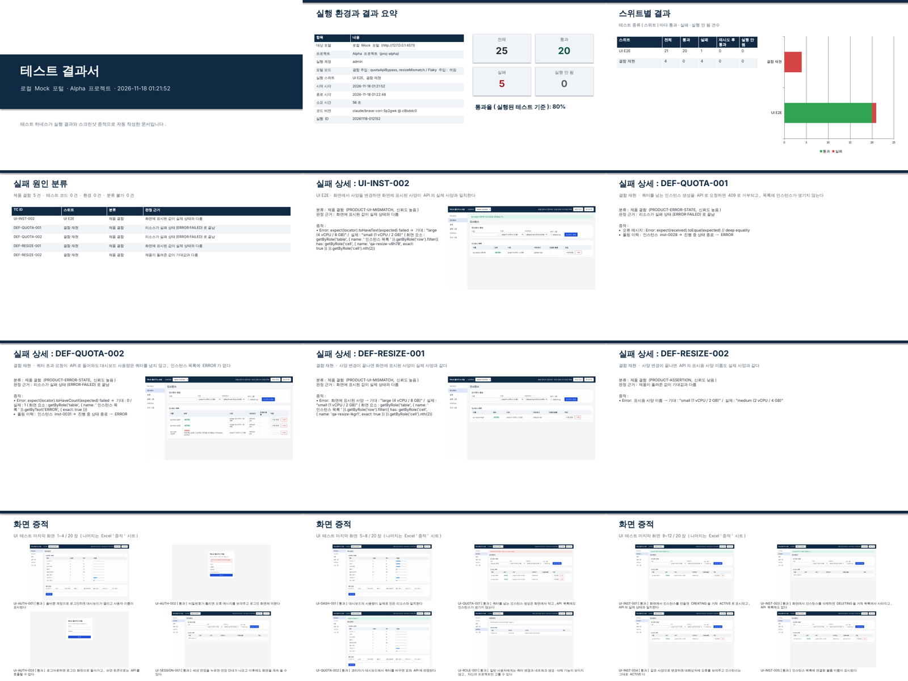

# Mock 클라우드 포털 QA 자동화 포트폴리오

작은 **Mock 클라우드 포털**(웹 콘솔 + REST API)을 직접 만들고, 그 위에 Playwright 기반 UI/API 테스트 자동화, 테스트 하네스(실행 → 증적 수집 → 결과서 자동 작성), GitHub Actions CI를 적용하는 저장소입니다.

> 이 저장소의 포털, 리소스, TC ID, 계정은 모두 가상입니다. 실제 회사·제품 정보는 들어 있지 않습니다.

## 진행 상태

단계별로 개발하고 있습니다. 완료한 단계만 체크합니다.

- [x] 0단계: 프로젝트 뼈대(TypeScript, ESLint, AI 작업 지침)
- [x] 1단계: Mock 포털 REST API
- [x] 2단계: 웹 콘솔 화면
- [x] 3단계: REST API 자동화(상태 폴링, 남은 리소스 일괄 삭제)
- [x] 4단계: Playwright UI E2E(Page Object Model)
- [x] 5단계: 네거티브 dataset 테스트
- [x] 6단계: 결함 주입과 결함 재현 테스트
- [x] 7단계: Flaky 재현과 안정화(naive / stable 비교)
- [x] 8단계: 실패 증적 수집과 실패 원인 자동 분류
- [x] 9단계: 테스트 하네스와 Excel·PPT 결과서
- [x] 10단계: CI 가드레일(판정 완화 변경 차단)
- [x] 11단계: GitHub Actions 워크플로
- [ ] 12단계: 시연 시나리오와 이력서 대응표 정리

## 지금 실행할 수 있는 것

Node.js 20 이상이 필요합니다.

```bash
npm ci
pip install -r harness/report/requirements.txt
npm run lint
npm run typecheck
npm run portal
npx playwright install chromium
npm test
npm run report
```

| 명령 | 하는 일 |
|---|---|
| `npm run portal` | Mock 포털만 띄운다 |
| `npm test` | 포털을 자동으로 띄운 뒤 전체 테스트를 실행한다 |
| `npm run test:api` | REST API 테스트만 실행한다 |
| `npm run test:ui` | UI E2E 테스트만 실행한다 |
| `npm run test:negative` | 네거티브 dataset 테스트만 실행한다 |
| `npm run test:defects` | 결함 재현 테스트만 실행한다(정상 모드에서는 모두 통과) |
| `npm run defects:check` | 결함 주입 모드마다 포털을 새로 띄워, 결함 재현 테스트가 결함을 정확히 검출하는지 확인한다 |
| `npm run test:flaky` | Flaky 재현 테스트(개선 전 naive, 개선 후 stable)를 실행한다. Flaky 플래그를 켜지 않으면 둘 다 통과한다 |
| `npm run flaky:compare` | 유형마다 naive와 stable을 같은 Flaky 플래그·같은 시드로 5회씩 실행해 실패율 표를 만든다(`-- --demo`: 확률 100%, 시드 고정) |
| `npm run harness` | 테스트 하네스: 환경·프로젝트 선택 → 실행 → 증적 수집 → 실패 원인 분류 → Excel·PPT 결과서 작성 |
| `npm run guardrail` | PR 변경(diff)에서 판정 기준을 느슨하게 만드는 변경을 찾는다(기본 비교 기준 `origin/main`) |
| `npm run guardrail:selftest` | 가드레일 규칙이 예시 diff에서 기대한 대로만 걸리는지 확인한다 |
| `npm run triage` | 마지막 테스트 결과(`artifacts/results.json`)의 실패를 product / test / env로 자동 분류해 결과서를 만든다 |
| `npm run triage:eval` | 정답을 붙인 실패 시나리오를 실제로 실행해 분류 정확도를 계산한다 |
| `npm run test:negative:high` | 네거티브 dataset 중 결함이 자주 나는 영역(`risk: high`)만 실행한다 |
| `npm run report` | Playwright HTML 리포트를 연다 |

`npm run portal`을 실행하면 `http://127.0.0.1:4173`에서 웹 콘솔이, `http://127.0.0.1:4173/api`에서 REST API가 뜹니다.

## Mock 포털 웹 콘솔


빌드 과정이 없는 정적 HTML과 바닐라 JS로 만들었습니다. 모든 입력란에 label을 붙이고 버튼에 접근 가능한 이름을 줘서, 테스트가 `getByRole`·`getByLabel`만으로 요소를 찾을 수 있습니다.

| 화면 | 할 수 있는 일 |
|---|---|
| 로그인 | 아이디·비밀번호로 로그인한다. 실패하면 오류 메시지를 보여준다. |
| 상단 바 | 작업할 프로젝트를 고르고, 세션 만료 시각을 확인하고, 세션을 연장하거나 로그아웃한다. |
| 대시보드 | 프로젝트의 사용량과 쿼터를 표로 보여준다. 관리자는 쿼터를 바꿀 수 있다. |
| 인스턴스 | 인스턴스를 만들고, 사양을 바꾸고, 삭제한다. 연결된 볼륨도 함께 보여준다. |
| 볼륨 | 볼륨을 만들고, 인스턴스에 연결·분리하고, 삭제한다. |
| 볼륨 그룹 | 볼륨 여러 개를 묶어 그룹을 만들고 삭제한다. |
| 네트워크 | 네트워크와 서브넷(IP 대역)을 만들고 삭제한다. 일반 사용자에게는 생성·삭제 기능을 보여주지 않는다. |
| 보안 그룹 | 보안 그룹과 규칙을 만들고 삭제한다. |

화면 동작에서 테스트가 알아야 할 점은 다음과 같습니다.

- 목록은 1초마다 자동으로 갱신되어, `CREATING`이 `ACTIVE`로 바뀌는 과정이 화면에 그대로 보입니다.
- 메뉴를 누르면 해당 화면을 처음부터 다시 그리고 최신 데이터를 불러옵니다.
- 쿼터를 넘는 생성 요청은 화면에서 먼저 막고 오류 메시지를 보여줍니다(서버도 같은 요청을 `409`로 거부합니다).
- 삭제, 사양 변경, 볼륨 연결, 서브넷 추가는 대화상자에서 확인한 뒤 요청합니다. 요청이 거부되면 대화상자 안에 오류를 보여주고 닫지 않습니다.
- 세션이 만료되면 로그인 화면으로 돌아가고 만료 안내 메시지를 보여줍니다.

## Mock 포털 REST API

데이터는 메모리에만 저장하고, 서버를 다시 띄우거나 리셋 API를 부르면 초기 상태로 돌아갑니다.

### 가상 계정과 프로젝트

| 계정 | 비밀번호 | 권한 | 접근할 수 있는 프로젝트 |
|---|---|---|---|
| `admin` | `admin-pass` | 관리자 | `proj-alpha`, `proj-beta` |
| `member` | `member-pass` | 일반 사용자 | `proj-alpha` |

- 로그인하면 토큰을 응답 본문과 `portal_token` 쿠키로 함께 받습니다. API를 부를 때는 `Authorization: Bearer <토큰>` 헤더를 씁니다.
- 작업할 프로젝트는 `X-Project-Id` 헤더로 고릅니다. 헤더가 없으면 사용자의 첫 번째 프로젝트를 씁니다.
- 쿼터 변경과 네트워크·서브넷 생성·삭제는 관리자만 할 수 있습니다.

### 엔드포인트

| 분류 | 엔드포인트 |
|---|---|
| 인증 | `POST /auth/login`, `POST /auth/extend`, `POST /auth/logout`, `GET /auth/me` |
| 환경 | `GET /environments`, `GET /projects`, `GET /flavors` |
| 인스턴스 | `GET·POST /instances`, `GET·DELETE /instances/:id`, `POST /instances/:id/resize` |
| 볼륨 | `GET·POST /volumes`, `GET·DELETE /volumes/:id`, `POST /volumes/:id/attach`, `POST /volumes/:id/detach` |
| 볼륨 그룹 | `GET·POST /volume-groups`, `GET·DELETE /volume-groups/:id` |
| 네트워크·서브넷 | `GET·POST /networks`, `GET·DELETE /networks/:id`, `GET·POST /networks/:id/subnets`, `DELETE /networks/:id/subnets/:subnetId` |
| 보안 그룹 | `GET·POST /security-groups`, `GET·DELETE /security-groups/:id` |
| 쿼터·사용량 | `GET·PUT /quota`, `GET /usage` |
| 테스트용 | `POST /test/reset`, `GET /test/flags` |

### 상태 전이

생성·삭제·사양 변경 요청은 바로 끝나지 않습니다. 요청은 '접수'만 하고, 실제 작업은 지연 시간(`TRANSITION_DELAY_MS`) 뒤에 끝납니다. 그래서 테스트는 응답 코드가 아니라 리소스 상태를 폴링해서 완료를 판정해야 합니다.

| 리소스 | 상태 전이 |
|---|---|
| 인스턴스 | `CREATING` → `ACTIVE` 또는 `ERROR`(서브넷이 없는 네트워크에 만들면 IP를 할당하지 못해 `ERROR`), `ACTIVE` → `RESIZING` → `ACTIVE`, `DELETING` → 목록에서 사라짐 |
| 볼륨 | `CREATING` → `AVAILABLE`, `ATTACHING` → `IN_USE`, `DETACHING` → `AVAILABLE`, `DELETING` → 목록에서 사라짐 |
| 볼륨 그룹 | `CREATING` → `AVAILABLE`, `DELETING` → 목록에서 사라짐 |

### 입력 규칙과 오류 응답

오류 응답은 `{ "error": { "code", "message", "field" } }` 형식으로 통일했습니다.

| 규칙 | 위반했을 때 |
|---|---|
| 이름은 3~30자이고, 영문 소문자로 시작하며 영문 소문자·숫자·하이픈만 쓴다 | `400 INVALID_LENGTH`, `400 INVALID_FORMAT` |
| 필수값을 빠뜨리면 안 된다 | `400 REQUIRED` |
| 볼륨 크기는 1~1000 GB | `400 OUT_OF_RANGE` |
| 서브넷 IP 대역은 네트워크 대역 안에 있어야 하고 다른 서브넷과 겹치면 안 된다 | `400 OUT_OF_RANGE`, `409 CIDR_OVERLAP` |
| 프로젝트 쿼터를 넘으면 안 된다 | `409 QUOTA_EXCEEDED` |
| 쓰이고 있는 리소스는 삭제할 수 없다(인스턴스가 쓰는 보안 그룹·네트워크, 볼륨 그룹에 속한 볼륨) | `400 RESOURCE_IN_USE` |
| 권한이 없는 작업이나 프로젝트에는 접근할 수 없다 | `403 FORBIDDEN` |
| 토큰이 없거나 만료되면 안 된다 | `401 UNAUTHENTICATED`, `401 TOKEN_EXPIRED` |

### 환경변수

| 환경변수 | 기본값 | 설명 |
|---|---|---|
| `PORTAL_PORT` | `4173` | 포털 포트 |
| `TRANSITION_DELAY_MS` | `1000` | 상태 전이에 걸리는 시간(ms) |
| `TOKEN_TTL_SEC` | `3600` | 토큰 유효 시간(초). 짧게 줄여 실행 중 세션 만료를 재현한다 |
| `DEFECT_QUOTA_API_BYPASS` | `false` | 결함 주입: 쿼터를 넘는 인스턴스 생성을 API가 접수해 ERROR 인스턴스가 생긴다 |
| `DEFECT_RESIZE_MISMATCH` | `false` | 결함 주입: 사양 변경 후 화면에 표시되는 사양 이름이 갱신되지 않는다 |
| `FLAKY_SEED` | 실행마다 무작위 | Flaky 주입 난수 시드. 고정하면 같은 요청 순서에서 같은 결과가 나온다 |
| `FLAKY_RATE` | - | 모든 Flaky 확률의 기본값(0~1). 개별 확률 변수가 있으면 그 값을 쓴다 |
| `FLAKY_DELETE_LAG` | `false` | ① 볼륨 그룹 삭제 지연과 늦은 400 |
| `FLAKY_DELETE_LAG_RATE` / `FLAKY_DELETE_LAG_MS` | `0.5` / `1500` | ① DELETING을 길게 유지할 확률과 유지 시간(ms) |
| `FLAKY_DELETE_LATE_400_RATE` | `0.5` | ① 콘솔에 삭제 재전송을 지시해 늦은 400을 만들 확률 |
| `FLAKY_LATE_RESPONSE` | `false` | ② 보안 그룹 삭제 응답 혼선 |
| `FLAKY_LATE_RESPONSE_RATE` / `FLAKY_LATE_RESPONSE_MS` | `0.5` / `800` | ② 삭제 처리를 늦추고 재전송을 지시할 확률과 지연 시간(ms) |
| `FLAKY_UI_STALE` / `FLAKY_UI_STALE_RATE` | `false` / `0.5` | ③ 화면을 열 때 목록 자동 갱신을 끌지, 그 확률 |
| `FLAKY_NETWORK` / `FLAKY_NETWORK_RATE` | `false` / `0.5` | ④ 리소스 조회 요청의 연결을 끊을지, 그 확률 |
| `FLAKY_NETWORK_COOLDOWN_MS` | `3000` | ④ 한 번 끊은 경로를 다시 끊지 않는 시간(ms). 재시도하면 회복할 수 있게 한다 |
| `FLAKY_TOKEN_ROTATE` / `FLAKY_TOKEN_ROTATE_RATE` | `false` / `0.5` | ④ 세션 연장 시 토큰을 교체할지, 그 확률 |

## REST API 자동화

### 판정 기준: '요청 성공'이 아니라 '실제 작업 완료'

포털의 생성·삭제·사양 변경 API는 요청을 접수만 하고 2xx를 돌려줍니다. 그래서 응답 코드만 보고 통과시키면, 실제로는 작업이 끝나지 않았거나 실패했는데도 테스트가 통과합니다. 이 저장소의 API 자동화는 아래 순서로 판정합니다.

| 단계 | 하는 일 | 코드 |
|---|---|---|
| 1. 요청과 응답을 짝짓는다 | 모든 요청은 `{ request, status, body, error }`로 묶인 결과를 돌려주고, HTTP 응답 이력(2xx 포함)에 기록된다. | `src/api/client.ts` |
| 2. 상태를 폴링한다 | 목록 API에서 리소스가 목표 상태(`ACTIVE`, `AVAILABLE` 등)가 되거나 목록에서 사라질 때까지 반복 조회한다. 관측한 상태 변화는 폴링 이력에 남긴다. | `src/api/poll.ts`, `src/api/actions.ts` |
| 3. 실패 상태는 바로 실패 처리한다 | `ERROR`·`FAILED`가 보이면 제한 시간까지 기다리지 않고 원인과 함께 실패시킨다. | `waitForStatus`, `waitForGone` |
| 4. 응답만으로 알 수 없으면 다시 확인한다 | 삭제가 HTTP 400·404로 끝나면 목록 API로 실제 상태를 확인한다. 이미 없거나 `DELETING`이면 삭제가 진행된 것이고, 그대로 남아 있으면 거부된 것이다. | `deleteAndWait` |

### 남은 리소스 일괄 삭제

테스트가 만든 리소스는 이름이 `qa-`로 시작합니다. 테스트가 끝날 때마다 `cleanupLeftovers`(`src/api/cleanup.ts`)가 이 접두어가 붙은 리소스를 한 번에 삭제합니다.

- 의존 관계 때문에 볼륨 그룹 → 볼륨(연결돼 있으면 먼저 분리) → 인스턴스 → 보안 그룹 → 네트워크 순서로 지웁니다.
- 생성 중이거나 변경 중인 리소스는 진행이 끝난 뒤에 지웁니다.
- 하나가 실패해도 멈추지 않고 끝까지 진행한 뒤, 삭제에 실패한 항목을 보고합니다. 실패한 항목이 있으면 그 테스트를 실패로 처리합니다.

### 로그인과 세션

- 스위트(워커)당 한 번만 로그인하고 모든 테스트가 같은 세션을 씁니다(`src/fixtures/api.ts`).
- 요청이 401을 받으면 제품 실패로 보지 않고, 다시 로그인해서 같은 요청을 한 번 더 보냅니다. 이 과정은 HTTP 응답 이력에 그대로 남습니다.
- 테스트가 실패하면 HTTP 응답 이력과 상태 폴링 이력을 리포트에 첨부합니다.

### API 테스트 목록 (`tests/api`)

TC ID는 이 저장소에서 만든 가상 ID입니다.

| TC ID | 확인하는 내용 |
|---|---|
| API-ENV-001 | 로그인 없이 환경 목록을 조회하고, 로그인 후 프로젝트와 사양을 조회한다 |
| API-AUTH-001 | 일반 사용자는 자신이 속한 프로젝트만 조회한다 |
| API-AUTH-002 | 토큰 없이 요청하면 401로 거부한다 |
| API-AUTH-003 | 쓰던 토큰이 무효가 되면 다시 로그인해서 요청을 이어간다 |
| API-INST-001 | 생성 요청 후 `ACTIVE`가 될 때까지 확인하고, 삭제 후 목록에서 사라졌는지 확인한다 |
| API-INST-002 | 사양 변경 요청 후 `RESIZING`을 거쳐 `ACTIVE`가 되면 새 사양이 적용된다 |
| API-INST-003 | 인스턴스가 `ERROR`가 되면 제한 시간까지 기다리지 않고 바로 실패로 판정한다 |
| API-INST-004 | 진행 중인 인스턴스 삭제는 400으로 거부되고, 목록 API로 확인하면 그대로 남아 있다 |
| API-VOL-001 | 볼륨을 만들어 인스턴스에 연결하고, 분리한 뒤 삭제한다 |
| API-VOL-002 | 연결된 볼륨 삭제는 400으로 거부되고 볼륨은 그대로 남는다 |
| API-VG-001 | 볼륨 그룹을 만들고 `AVAILABLE`이 될 때까지 기다린 뒤, 삭제가 실제로 끝났는지 확인한다 |
| API-NET-001 | 네트워크와 서브넷을 만들고 조회한 뒤 삭제한다 |
| API-SG-001 | 규칙이 있는 보안 그룹을 만들고 삭제한다 |
| API-SG-002 | 인스턴스가 쓰는 보안 그룹 삭제는 400으로 거부되고, 목록 API로 확인하면 그대로 남아 있다 |
| API-USAGE-001 | 사용량 API의 값이 실제로 만든 리소스와 일치한다 |
| API-CLEAN-001 | 테스트가 남긴 리소스를 의존 순서대로 한 번에 삭제하고, 기본 리소스는 남긴다 |

## UI E2E 자동화

API 테스트만으로는 화면에서만 드러나는 결함(화면 표시가 실제 상태와 다름, 화면에서 막아야 할 입력을 막지 못함, 권한 없는 기능이 보임)을 잡을 수 없습니다. 그래서 같은 포털의 웹 콘솔을 Playwright로 자동화했습니다.

### 구조: Page Object Model

| 계층 | 담당 | 위치 |
|---|---|---|
| Page Object | 화면 요소를 찾는 locator와 클릭·입력 같은 action만 가진다. 기대값 확인은 하지 않는다. | `src/pages/` |
| Fixture | 로그인된 콘솔을 준비하고, 테스트가 끝나면 남은 리소스를 정리한다. | `src/fixtures/ui.ts` |
| 테스트 | 시나리오와 assertion만 표현한다. | `tests/ui/` |

- 화면 요소는 모두 `getByRole`, `getByLabel`, `getByText`로 찾습니다. CSS 선택자나 XPath는 쓰지 않습니다.
- 목록 화면의 공통 부분(표, 행 찾기, 생성 폼, 확인 대화상자)은 `ResourceListPage`에 모았고, 화면마다 다른 부분만 각 Page Object가 가집니다.
- 메뉴를 누른 직후에는 이전 화면이 잠깐 남아 있습니다. 그래서 `ConsolePage`는 새 화면의 제목이 나타난 뒤에 해당 Page Object를 돌려줍니다.
- 고정 시간 대기(`waitForTimeout`)는 쓰지 않습니다. 상태 변화는 `expect(locator).toHaveText('ACTIVE')`처럼 조건이 충족될 때까지 기다리는 assertion으로 확인합니다.

### 로그인과 리소스 준비

- 화면에서 매번 로그인하지 않습니다. 스위트당 한 번 API로 로그인해 받은 토큰을 브라우저 쿠키에 넣어 재사용합니다. 로그인 화면 자체는 `UI-AUTH-*` 테스트에서만 다룹니다.
- 테스트의 사전 조건이 되는 리소스(예: 사양 변경 대상 인스턴스)는 화면이 아니라 API로 만듭니다. 화면 조작은 그 테스트가 확인하려는 동작에만 씁니다.
- 화면에서 확인한 결과는 API로도 다시 확인합니다. 화면 표시와 실제 리소스 상태가 어긋나는 결함을 잡기 위해서입니다.

### UI 테스트 목록 (`tests/ui`)

| TC ID | 확인하는 내용 |
|---|---|
| UI-AUTH-001 | 올바른 계정으로 로그인하면 대시보드가 열리고 사용자 이름이 표시된다 |
| UI-AUTH-002 | 비밀번호가 틀리면 오류 메시지를 보여주고 로그인 화면에 머문다 |
| UI-AUTH-003 | 로그아웃하면 로그인 화면으로 돌아가고, 쓰던 토큰으로는 API를 호출할 수 없다 |
| UI-SESSION-001 | 세션 연장을 누르면 연장 안내가 나오고 이후에도 화면을 계속 쓸 수 있다 |
| UI-INST-001 | 화면에서 인스턴스를 만들면 `CREATING`을 거쳐 `ACTIVE`로 표시되고, API의 실제 상태와 일치한다 |
| UI-INST-002 | 화면에서 사양을 변경하면 화면에 표시된 사양이 API의 실제 사양과 일치한다 |
| UI-INST-003 | 화면에서 인스턴스를 삭제하면 `DELETING`을 거쳐 목록에서 사라지고, API 목록에도 없다 |
| UI-INST-004 | 같은 사양으로 변경하면 대화상자에 오류를 보여주고 인스턴스는 그대로 `ACTIVE`다 |
| UI-INST-005 | 인스턴스 목록에 연결된 볼륨 이름이 표시된다 |
| UI-VOL-001 | 화면에서 볼륨을 만들어 인스턴스에 연결하고 분리한다 |
| UI-VOL-002 | 화면에서 볼륨을 삭제하면 목록에서 사라지고, API 목록에도 없다 |
| UI-VG-001 | 화면에서 볼륨 그룹을 만들고 삭제하면, 그룹이 사라진 뒤 볼륨은 그룹에서 풀려난다 |
| UI-VG-002 | 볼륨 그룹에 속한 볼륨을 삭제하려 하면 대화상자에 오류를 보여주고 볼륨은 그대로 남는다 |
| UI-NET-001 | 화면에서 네트워크를 만들고 서브넷을 추가하면 목록에 IP 대역이 표시된다 |
| UI-NET-002 | 네트워크 대역을 벗어난 서브넷은 대화상자에 오류를 보여주고 추가되지 않는다 |
| UI-SG-001 | 화면에서 규칙이 있는 보안 그룹을 만들면 목록에 규칙이 표시된다 |
| UI-SG-002 | 인스턴스가 쓰는 보안 그룹을 삭제하려 하면 대화상자에 오류를 보여주고 보안 그룹은 그대로 남는다 |
| UI-DASH-001 | 대시보드의 사용량이 실제로 만든 리소스와 일치한다 |
| UI-QUOTA-001 | 쿼터를 넘는 인스턴스 생성은 화면에서 막고, API 목록에도 인스턴스가 생기지 않는다 |
| UI-QUOTA-002 | 관리자가 대시보드에서 쿼터를 바꾸면 표와 API에 반영된다 |
| UI-ROLE-001 | 일반 사용자에게는 쿼터 변경과 네트워크 생성·삭제 기능이 보이지 않고, 자신의 프로젝트만 고를 수 있다 |

## 네거티브 dataset 테스트

입력 규칙을 어긴 요청을 시스템이 제대로 거부하는지 확인하는 테스트입니다. 케이스를 코드가 아니라 JSON dataset으로 관리하고, 정상 흐름 테스트(`tests/api`, `tests/ui`)와 분리해 버전마다 같은 dataset을 반복 실행할 수 있게 했습니다.

### 구성

| 파일 | 내용 | 케이스 수 |
|---|---|---|
| `tests/negative/datasets/api-instance.json` | 인스턴스 이름 경계값·형식, 사양·네트워크 참조, 쿼터, 진행 중 상태의 작업 | 20 |
| `tests/negative/datasets/api-volume.json` | 볼륨 크기 경계값·형식, 용량 쿼터, 연결·삭제 상태, 볼륨 그룹 구성 | 14 |
| `tests/negative/datasets/api-network.json` | IP 대역 형식·prefix 범위·호스트 비트, 서브넷 범위·중복, 보안 그룹 규칙 | 12 |
| `tests/negative/datasets/api-auth.json` | 토큰 없음·무효·만료, 관리자 전용 기능, 다른 프로젝트 접근 | 10 |
| `tests/negative/datasets/ui-volume-form.json` | 볼륨 생성 화면의 이름·크기 입력과 쿼터 차단 | 9 |

케이스 하나는 아래 정보를 가집니다.

- `category`: 경계값(`boundary`), 필수값 누락(`required`), 형식(`format`), 참조(`reference`), 중복(`duplicate`), 쿼터 초과(`quota`), 상태(`state`), 권한 없음(`permission`), 인증(`auth`)
- `risk`: 결함이 자주 나는 영역이면 `high`입니다. 쿼터 초과, 진행 중 상태의 작업, 권한, 서브넷 대역처럼 화면에서는 막히지만 API로 직접 요청하면 뚫리기 쉬운 영역을 `high`로 골랐고, 고른 이유는 dataset 파일의 `riskReason`에 적었습니다. API dataset 56건 중 20건, 화면 dataset 9건 중 1건이 `high`입니다.
- `setup`: 사전 준비(인스턴스·볼륨·네트워크 생성, 볼륨 연결, 쿼터 임시 변경). 쿼터를 바꾼 케이스는 끝나면 원래 쿼터로 되돌립니다.
- `request`, `expect`: 보낼 요청과 기대하는 응답 코드·오류 코드·오류 필드
- `verify`: 응답을 받은 뒤 목록 API로 확인할 실제 상태

경계값은 실패하는 값만이 아니라 통과해야 하는 값(이름 3자·30자, 볼륨 1 GB·1000 GB)도 함께 넣어, 경계가 한쪽으로 밀린 결함도 잡을 수 있게 했습니다.

### 판정 절차

실행기(`tests/negative/api-negative.spec.ts`)는 케이스마다 같은 절차로 판정합니다.

1. 응답 코드, 오류 코드, 오류 필드가 기대와 같은지 확인합니다.
2. 응답만 믿지 않고 목록 API로 실제 상태를 확인합니다. 생성 요청이면 리소스가 생기지 않았는지, 변경·삭제 요청이면 대상이 그대로 남아 있는지 봅니다.
3. 거부된 요청이면 프로젝트 사용량과 쿼터가 요청 전과 같은지 확인합니다. 응답은 거부였는데 실제로는 리소스가 만들어져 사용량이 바뀌는 결함을 잡기 위해서입니다.

화면 dataset 실행기(`tests/negative/ui-negative.spec.ts`)는 화면에 기대한 오류 메시지가 표시되는지, 그리고 목록 API에 볼륨이 생기지 않았는지를 함께 확인합니다.

### 실행

```bash
npm run test:negative        # 전체 65건
npm run test:negative:high   # risk: high 21건만
npx playwright test --project=negative --grep @quota   # 분류별 실행(예: 쿼터)
```

케이스를 추가할 때는 dataset JSON에 항목만 추가하면 됩니다. 실행기가 테스트를 만들기 전에 dataset 형식(ID 형식과 중복, 필수 항목)을 검사하므로, 형식이 틀리면 바로 실패합니다.

## 결함 재현 테스트

실무에서 겪은 결함 유형을 **같은 원인 구조로 만든 가상 시나리오**로 재현했습니다. 포털을 결함 주입 플래그와 함께 띄우면 결함이 생기고, 결함 재현 테스트(`tests/defects`)는 정상 모드에서는 통과하고 결함 모드에서는 결함을 검출해 실패합니다.

| 결함 | 원인 구조 | 결함 주입 플래그 | 검출하는 테스트 |
|---|---|---|---|
| 쿼터 초과 API 우회 | 화면은 쿼터를 넘는 인스턴스 생성을 막지만, API는 쿼터를 검사하지 않고 요청을 접수한다. 인스턴스는 ERROR로 생성되고, ERROR 인스턴스까지 사용량에 집계되어 대시보드 사용량이 쿼터를 넘는다. | `DEFECT_QUOTA_API_BYPASS=true` | `DEF-QUOTA-001`(API 응답과 실제 생성 결과), `DEF-QUOTA-002`(대시보드 사용량과 인스턴스 목록) |
| 사양 변경 후 표시 사양 불일치 | 무중단 사양 변경이 끝나면 실제 사양(`flavorId`)은 바뀌지만, 화면에 표시하는 사양 이름(`flavorName`)은 갱신되지 않는다. `flavorId`만 확인하는 API 테스트는 통과한다. | `DEFECT_RESIZE_MISMATCH=true` | `DEF-RESIZE-001`(화면 표시 사양과 실제 사양 비교), `DEF-RESIZE-002`(API의 표시용 사양 이름과 실제 사양 비교) |

### 결함 검출 확인

`npm run defects:check`는 모드마다 다른 포트로 포털을 새로 띄워 결함 재현 테스트를 실행하고, 실패한 테스트가 기대 목록(`tests/defects/expected-detection.json`)과 정확히 같은지 판정합니다. 기대보다 적게 실패하면 결함을 놓친 것이고, 많이 실패하면 결함과 상관없는 테스트가 깨진 것이므로 둘 다 불일치로 처리합니다.

이 저장소에서 실제로 실행한 결과입니다.

| 모드 | 실행 | 실패(검출) | 기대한 실패 | 판정 |
|---|---|---|---|---|
| normal | 4 | 없음 | 없음 | 일치 |
| quota-api-bypass | 4 | DEF-QUOTA-001, DEF-QUOTA-002 | DEF-QUOTA-001, DEF-QUOTA-002 | 일치 |
| resize-mismatch | 4 | DEF-RESIZE-001, DEF-RESIZE-002 | DEF-RESIZE-001, DEF-RESIZE-002 | 일치 |

### 결함 모드에서 기존 테스트가 무엇을 잡았는가

결함 모드로 정상 흐름 테스트(API·UI)와 네거티브 dataset을 함께 실행한 결과입니다. 어떤 종류의 테스트가 어떤 결함을 잡는지 보여줍니다.

| 결함 모드 | 실행(API·UI·네거티브) | 결함을 잡은 테스트 | 놓친 테스트와 이유 |
|---|---|---|---|
| 쿼터 초과 API 우회 | 102건 중 100건 통과, 2건 실패 | 네거티브 dataset `NEG-INST-015`, `NEG-INST-016`(API로 쿼터 초과를 직접 요청) | UI 테스트 `UI-QUOTA-001`은 통과했다. 화면이 요청을 먼저 막아서 API까지 가지 않기 때문이다. 화면 검증만으로는 이 결함을 잡을 수 없다. |
| 사양 변경 후 표시 사양 불일치 | 102건 중 101건 통과, 1건 실패 | UI 테스트 `UI-INST-002`(화면의 사양 표시와 API의 실제 사양 비교) | API 테스트 `API-INST-002`는 통과했다. `flavorId`만 확인하므로 화면 표시가 틀린 것을 알 수 없다. API 자동화만으로는 잡을 수 없는 결함이다. |

두 결함은 서로 반대 방향입니다. 쿼터 우회는 화면 테스트가 놓치고 API(네거티브) 테스트가 잡았고, 표시 사양 불일치는 API 테스트가 놓치고 화면 테스트가 잡았습니다. API 자동화와 UI 자동화를 함께 두는 이유입니다.

### 실행 모드 안전장치

모든 테스트는 시작 전에 포털의 `GET /api/test/flags`를 조회해, 테스트가 기대한 결함 주입 모드와 실제로 떠 있는 포털의 모드가 같은지 확인합니다. 다르면 테스트를 시작하지 않고 멈춥니다. 예를 들어 정상 모드로 떠 있는 포털을 결함 모드 테스트가 재사용하면, 결함이 없는데 "결함을 검출하지 못했다"는 잘못된 결과가 나오기 때문입니다.

## Flaky 재현과 안정화

실무에서 테스트가 회차마다 다른 결과를 냈던 원인을 **같은 원인 구조로 만든 가상 시나리오**로 재현했습니다. 실무 사례를 그대로 복제하지 않고, Mock 포털의 Flaky 주입 플래그로 원인만 재현합니다.

유형마다 개선 전 테스트(`tests/flaky/naive`)와 개선 후 테스트(`tests/flaky/stable`)를 같은 TC ID로 함께 두었습니다. 두 테스트는 같은 화면 조작을 하고, 응답을 해석하는 방법과 완료를 판정하는 기준만 다릅니다. 같은 Flaky 플래그에서 naive는 간헐적으로 실패하고 stable은 통과해야 합니다.

### 실무 사례 → 재현 방식 → 개선 전/후 테스트 파일

①②는 실무처럼 **브라우저가 받은 네트워크 응답**을 잘못 해석하는 구조로 재현했습니다. 포털이 응답 헤더(`x-portal-retry-ms`)로 게이트웨이 시간 초과를 흉내 내면, 콘솔은 같은 삭제 요청을 백그라운드로 한 번 더 보냅니다. 이 재전송은 화면에는 보이지 않고 네트워크에만 남으며, 이미 삭제 중인 리소스에 대한 요청이라 400을 받습니다.

| 유형 | 실무 사례(원인) | 재현 방식(포털 동작) | 개선 전(naive) | 개선 후(stable) | 테스트 파일 |
|---|---|---|---|---|---|
| ① 실제 리소스 상태 불일치 | 삭제 API는 성공을 돌려줬지만 리소스는 DELETING으로 한동안 남아 있었고, 이후 늦게 온 400을 무조건 실패로 처리해 결과가 회차마다 달랐다. | `FLAKY_DELETE_LAG`: 볼륨 그룹 삭제는 바로 `200 { successCount: 1 }`을 돌려주지만, 확률에 따라 DELETING이 1.5초 유지되고, 확률에 따라 재전송된 삭제가 늦게 400을 받는다. | 삭제 응답이 200이면 완료로 보고 고정 1초 뒤 목록을 확인한다. 테스트 중 4xx가 하나라도 오면 실패로 본다. | 이 단계의 DELETE(메서드·URL·리소스 ID) 응답만 해석한다. 400이면 목록 API로 실제 상태를 다시 확인한다. 목록에서 사라질 때까지 폴링하고, ERROR·FAILED면 바로 실패한다. | `tests/flaky/naive/delete-lag.spec.ts` → `tests/flaky/stable/delete-lag.spec.ts` |
| ② API 응답 혼선 | 이전 단계에서 늦게 도착한 400을 현재 작업의 결과로 오판했다. A 삭제의 늦은 실패를 B의 실패로 판단했다. | `FLAKY_LATE_RESPONSE`: 확률에 따라 보안 그룹 삭제 처리가 0.8초 늦어지고 재전송이 일어나며, 재전송의 400은 0.4초 더 늦게 도착해 다음 단계(B 삭제) 도중에 들어온다. | 단계 구분 없이 '다음에 오는 DELETE 응답'을 현재 작업의 결과로 본다. | 단계마다 그 단계의 DELETE와 메서드·URL·리소스 ID가 같은 응답만 짝짓는다. 400이면 목록 API로 다시 확인하고, 목록에서 사라질 때까지 폴링한다. | `tests/flaky/naive/late-response.spec.ts` → `tests/flaky/stable/late-response.spec.ts` |
| ③ UI 반영 지연 | API로는 이미 AVAILABLE인데 화면은 새로고침 전 행을 계속 CREATING으로 보여줬다. | `FLAKY_UI_STALE`: 화면을 열 때마다 확률에 따라 목록 자동 갱신이 꺼진다. 메뉴로 다시 열어야 최신 상태가 보인다. | 고정 2초를 기다린 뒤 화면에 있던 행을 그대로 다시 읽는다. | API로 AVAILABLE을 확인한 뒤 메뉴로 목록을 다시 열고, 화면에 기대한 상태가 나타날 때까지 조건부로 기다린다(고정 대기 없음). | `tests/flaky/naive/ui-stale.spec.ts` → `tests/flaky/stable/ui-stale.spec.ts` |
| ④ 환경·네트워크 오류(네트워크 끊김) | 네트워크 변경 오류(ERR_NETWORK_CHANGED)로 테스트가 중단됐고, 제품 실패와 구분하지 못했다. | `FLAKY_NETWORK`: 리소스 조회(GET) 요청의 연결을 확률에 따라 응답 없이 끊는다. 브라우저는 `Failed to fetch`, 테스트 코드는 `socket hang up`을 받는다. 같은 경로는 3초 동안 다시 끊지 않는다. | 네트워크 오류를 다른 실패와 똑같이 다룬다. 다시 시도하지 않고 원인도 남기지 않는다. | 조회 요청이 네트워크 오류로 끝나면 env로 기록하고 3번까지 다시 보낸다. 화면이 네트워크 오류로 열리지 않으면 env로 기록하고 다시 연다. 네트워크 오류가 아닌 오류는 product로 기록하고 바로 실패한다. 회복하지 못하면 `[env]`를 붙여 실패시킨다. | `tests/flaky/naive/network.spec.ts` → `tests/flaky/stable/network.spec.ts` |
| ④ 환경·네트워크 오류(토큰 교체) | UI 세션 연장 시 쿠키만 바뀌고 API 요청 헤더는 예전 토큰을 써서 401이 발생했다. | `FLAKY_TOKEN_ROTATE`: 화면에서 세션을 연장하면 확률에 따라 쿠키 토큰을 새로 발급하고 이전 토큰을 무효화한다. | 처음 읽은 쿠키 토큰을 테스트 끝까지 쓴다. | 상태를 폴링할 때마다 쿠키에서 토큰을 다시 읽는다. 401·403이면 env로 기록하고 다시 로그인해 인증 헤더를 받아 온다. | `tests/flaky/naive/token-rotate.spec.ts` → `tests/flaky/stable/token-rotate.spec.ts` |

> 재현 시나리오는 실무 사례를 **같은 원인 구조로 만든 가상 시나리오**입니다. 실무의 화면, 데이터, 코드를 옮긴 것이 아닙니다.

### 네 유형 공통 변경

- **스위트당 로그인 1회, 프로젝트 재사용**: 로그인은 워커(스위트)당 한 번만 하고, 모든 테스트가 같은 세션과 같은 프로젝트를 씁니다(`src/fixtures/api.ts`).
- **판정 기준 변경**: '요청 성공(2xx)'이 아니라 '리소스 상태를 확인한 뒤 실제 작업 완료'로 판정합니다.
- **Not Run 별도 집계**: 비교 스크립트는 실행되지 않은 회차(포털 기동 실패, 테스트 미실행)를 실패와 섞지 않고 `Not Run`으로 따로 세고, 실패율은 실제로 실행된 회차만으로 계산합니다.

### 개선 전/후 반복 비교 결과

`npm run flaky:compare`는 유형마다 naive와 stable을 **같은 Flaky 플래그, 같은 시드**로 N회(기본 5회)씩 실행합니다. 회차마다 포털을 새로 띄우고 시드를 바꿉니다(naive와 stable은 같은 회차에 같은 시드를 씁니다). stable이 한 번이라도 실패하거나 실행되지 않으면 스크립트가 실패로 끝납니다.

아래 '이 저장소의 결과'는 이 저장소에서 실제로 실행한 수치입니다.

**이 저장소의 결과(일반 비교)**: 조건: 회차 5회, Flaky 확률 0.5, 시드 1001~1005, 실행일 2026-11-18

| 유형 | TC ID | Flaky 플래그 | 테스트 | 실행 | 실패 | Not Run | 실패율 |
|---|---|---|---|---|---|---|---|
| ① 실제 리소스 상태 불일치 | FLAKY-DEL-001 | `FLAKY_DELETE_LAG` | 개선 전(naive) | 5 | 3 | 0 | 60% |
| ① 실제 리소스 상태 불일치 | FLAKY-DEL-001 | `FLAKY_DELETE_LAG` | 개선 후(stable) | 5 | 0 | 0 | 0% |
| ② API 응답 혼선 | FLAKY-RESP-001 | `FLAKY_LATE_RESPONSE` | 개선 전(naive) | 5 | 2 | 0 | 40% |
| ② API 응답 혼선 | FLAKY-RESP-001 | `FLAKY_LATE_RESPONSE` | 개선 후(stable) | 5 | 0 | 0 | 0% |
| ③ UI 반영 지연 | FLAKY-UI-001 | `FLAKY_UI_STALE` | 개선 전(naive) | 5 | 2 | 0 | 40% |
| ③ UI 반영 지연 | FLAKY-UI-001 | `FLAKY_UI_STALE` | 개선 후(stable) | 5 | 0 | 0 | 0% |
| ④ 환경·네트워크 오류(네트워크 끊김) | FLAKY-NET-001 | `FLAKY_NETWORK` | 개선 전(naive) | 5 | 4 | 0 | 80% |
| ④ 환경·네트워크 오류(네트워크 끊김) | FLAKY-NET-001 | `FLAKY_NETWORK` | 개선 후(stable) | 5 | 0 | 0 | 0% |
| ④ 환경·네트워크 오류(토큰 교체) | FLAKY-TOKEN-001 | `FLAKY_TOKEN_ROTATE` | 개선 전(naive) | 5 | 2 | 0 | 40% |
| ④ 환경·네트워크 오류(토큰 교체) | FLAKY-TOKEN-001 | `FLAKY_TOKEN_ROTATE` | 개선 후(stable) | 5 | 0 | 0 | 0% |

naive는 같은 플래그에서도 시드(회차)에 따라 통과하기도 하고 실패하기도 했고(실패율 40~80%), stable은 25회 모두 통과했습니다.

**이 저장소의 결과(5분 데모 모드, `--demo`)**: 조건: 회차 3회, Flaky 확률 1, 시드 7 고정, 실행일 2026-11-18

| 유형 | TC ID | 개선 전(naive) 실행/실패 | 개선 후(stable) 실행/실패 |
|---|---|---|---|
| ① 실제 리소스 상태 불일치 | FLAKY-DEL-001 | 3 / 3 (100%) | 3 / 0 (0%) |
| ② API 응답 혼선 | FLAKY-RESP-001 | 3 / 3 (100%) | 3 / 0 (0%) |
| ③ UI 반영 지연 | FLAKY-UI-001 | 3 / 3 (100%) | 3 / 0 (0%) |
| ④ 환경·네트워크 오류(네트워크 끊김) | FLAKY-NET-001 | 3 / 3 (100%) | 3 / 0 (0%) |
| ④ 환경·네트워크 오류(토큰 교체) | FLAKY-TOKEN-001 | 3 / 3 (100%) | 3 / 0 (0%) |

수치는 실행 환경(머신 속도)에 따라 달라질 수 있습니다. 직접 실행한 결과는 `artifacts/flaky-compare/summary.md`에 저장됩니다.

#### 측정 중 발견해서 고친 문제

처음 측정했을 때 확률 50%인 토큰 교체가 5회 모두 일어나 naive 실패율이 100%로 나왔습니다. 확인해 보니 포털의 난수 생성기에 연속된 시드(1001~1005)를 그대로 넣으면 첫 난수가 모두 0.5 미만(0.14~0.43)으로 비슷하게 나왔습니다. 회차마다 확률이 독립적으로 동작하지 않은 것입니다. 시드를 한 번 섞은 뒤 쓰도록 고치고 다시 측정한 결과가 위 표입니다.

#### 실무 성과와 이 저장소 결과의 구분

| 구분 | 내용 |
|---|---|
| 실무 성과(이력서 수치) | 생성 10건·삭제 8건, 총 18건을 각 5회(총 90회) 실행해 모두 PASS. Flaky 실패율 약 60% → 0% |
| 이 저장소에서 재현한 내용(실행 결과) | 위 표의 수치. 가상 포털에서 원인 구조만 재현한 5건(유형 4개)을 naive·stable 각 5회 실행한 결과이며, 실무 수치와 직접 비교하는 값이 아니다 |

### 5분 데모용 실행

```bash
npm run flaky:compare -- --demo
```

Flaky 확률을 100%로, 시드를 7로 고정해 각 3회 실행합니다. naive는 매번 실패하고 stable은 매번 통과해서, 면접 시연에서 같은 결과를 보여줄 수 있습니다.

### 실패 증적

- Flaky 테스트는 콘솔(브라우저)이 받은 API 응답까지 HTTP 응답 이력에 남깁니다. 각 기록에는 요청 주체(`api`/`browser`)와 재전송 여부(`retry`)가 붙고, 네트워크 오류는 `status: 0`, `NETWORK_ERROR`로 남습니다.
- stable 테스트가 만난 문제는 원인별 로그(`cause-log.json`)에 `env`/`product`/`test`와 회복 여부를 붙여 남깁니다.
- 테스트가 실패하면 포털이 실제로 주입한 Flaky 이력(`GET /api/test/flaky-events`)도 함께 첨부해서, 실패가 주입된 지연·재전송·연결 끊김과 겹쳤는지 확인할 수 있게 했습니다.

## 실패 원인 자동 분류

테스트가 실패하면 원인이 제품 결함인지, 테스트 코드 문제인지, 실행 환경 문제인지부터 가려야 합니다. 이 판단을 사람이 증적을 하나씩 열어 보며 하지 않도록, 실패마다 증적을 남기고 규칙으로 먼저 분류합니다.

### 실패 증적

실패한 테스트에는 아래 증적이 Playwright 리포트에 첨부되고, 분류기는 JSON 결과에서 이 증적을 읽습니다.

| 증적 | 내용 | 남기는 곳 |
|---|---|---|
| `http-history.json` | 테스트 코드와 콘솔(브라우저)이 보낸 모든 API 요청의 응답 이력. 2xx 응답도 포함하고, 요청 주체(`api`/`browser`), 재전송 여부, 응답을 받지 못한 요청(`status: 0`)을 함께 남긴다 | `src/api/client.ts`, `src/flaky/network.ts` |
| `poll-history.json` | 상태 폴링에서 관측한 상태 변화(예: `CREATING → ERROR`) | `src/api/poll.ts` |
| `cause-log.json` | 테스트가 실행 중에 만난 문제와 원인 분류(env/product/test), 회복 여부 | `src/api/evidence.ts` |
| `flaky-events.json` | 포털이 실제로 주입한 지연·재전송·연결 끊김·토큰 교체 이력 | 포털 `GET /api/test/flaky-events` |
| 스크린샷, trace | 실패 시점 화면과 동작 기록 | Playwright 설정 |

### 분류 규칙

규칙은 `harness/triage/rules.ts`에 목록으로 관리합니다. 위에서부터 차례로 보고 처음 맞은 규칙으로 판정합니다. 환경(env) 규칙을 먼저 보는 이유는, 네트워크가 끊기면 화면 요소도 못 찾고 응답도 틀리게 보여서 뒤의 규칙들이 잘못 맞기 때문입니다.

| 규칙 | 분류 | 판정하는 상황 |
|---|---|---|
| `ENV-PORTAL-MODE` | env | 테스트가 기대한 포털 실행 모드(결함·Flaky 주입)와 실제 모드가 다름 |
| `ENV-PORTAL-DOWN` | env | 포털에 연결할 수 없음 |
| `ENV-NETWORK` | env | 응답을 받지 못한 네트워크 오류(연결 끊김). 화면 요소를 못 찾은 실패라도 그 사이 네트워크 오류가 있었으면 여기로 분류 |
| `ENV-AUTH-TOKEN` | env | 세션 연장이나 토큰 교체 뒤 401·403을 받음. 인증·권한을 검증하는 테스트(`@auth`, `@permission`)는 제외 |
| `TEST-DATASET` | test | dataset 형식 오류 |
| `TEST-CODE-ERROR` | test | 테스트 코드 실행 오류(TypeError 등) |
| `TEST-DATA-CONFLICT` | test | 테스트가 준비한 데이터가 기존 데이터와 이름이 겹침 |
| `TEST-RESPONSE-PAIRING` | test | 화면에 보이지 않는 재전송 요청의 4xx를 현재 단계의 결과로 해석함 |
| `TEST-FIXED-WAIT` | test | 고정 시간(`waitForTimeout`)을 기다린 뒤 바로 판정함 |
| `TEST-LOCATOR` | test | 화면 요소를 찾지 못함(없는 이름, 여러 개에 맞음) |
| `PRODUCT-ERROR-STATE` | product | 리소스가 ERROR·FAILED 상태로 끝남 |
| `PRODUCT-API-CONTRACT` | product | API 응답 코드·오류 코드가 입력 규칙과 다름 |
| `PRODUCT-UI-MISMATCH` | product | 화면 요소는 찾았지만 표시된 값이 기대와 다름 |
| `PRODUCT-ASSERTION` | product | 그 밖에 제품이 돌려준 값이 기대와 다름(넓은 규칙) |

- 판정 결과에는 판정 근거(기대값과 실제값, 관련 요청, 폴링 이력, 포털의 주입 이력)가 함께 남습니다.
- 다른 분류를 가리키는 규칙도 맞으면 **반대 증거**로 표시하고 신뢰도를 '낮음'으로 둡니다. 넓은 규칙(`PRODUCT-ASSERTION`)으로만 판정한 경우도 신뢰도 '낮음'입니다.
- `npm run triage`는 결과를 `artifacts/triage/triage.md`, `triage.json`으로 남기고, GitHub Actions에서는 Job Summary에도 씁니다.

### AI 실패 원인 추천(선택 기능)

`TRIAGE_AI=1 npm run triage`로 실행하면, 실패마다 증적(오류 메시지, 오류 위치 주변 코드, HTTP·폴링 이력, 원인 로그, 주입 이력)을 Claude API에 보내 원인 추천을 받습니다.

- 규칙 기반 판정을 대신하지 않고, 결과서에 **참고 의견** 열로만 붙습니다. 규칙 판정과 다르면 "(규칙과 다름)"으로 표시합니다.
- 공식 SDK(`@anthropic-ai/sdk`)의 구조화 출력(`output_config.format`, Zod 스키마)으로 `{ category, reason, nextAction }` 형식의 응답만 받습니다. 기본 모델은 `claude-opus-5-5`이고 `TRIAGE_AI_MODEL`로 바꿀 수 있습니다. 응답이 거절되면 서버가 다른 모델로 다시 실행하는 fallback 옵션을 켰습니다.
- 다음 조치로 판정 완화(assert 삭제, retry·timeout 증가, skip)를 제안하지 않도록 지시했습니다.
- 인증 정보가 없거나 호출이 실패하면 규칙 기반 결과만 남기고 "추천 없음"으로 표시합니다.

### 분류 정확도(이 저장소에서 실행한 결과)

`npm run triage:eval`은 정답(라벨)을 붙인 실패 시나리오(`tests/triage/labels.json`)를 실제로 실행해 실패를 만들고, 분류 결과를 정답과 비교합니다. 시나리오는 결함 주입 모드(product), 개선 전 Flaky 테스트(test·env), 일부러 실패하게 만든 샘플 테스트 6건(`tests/triage-samples`, `TRIAGE_SAMPLES=1`일 때만 실행)으로 구성했습니다.

조건: 라벨 17건, 실행일 2026-11-18

규칙 기반 분류 정확도: 16 / 17 (94.1%)

| 시나리오 | TC ID | 정답 | 규칙 판정 | 규칙 | 신뢰도 | 일치 |
|---|---|---|---|---|---|---|
| 결함: 쿼터 초과 API 우회 | DEF-QUOTA-001 | 제품 결함(product) | 제품 결함(product) | PRODUCT-ERROR-STATE | 높음 | O |
| 결함: 쿼터 초과 API 우회 | DEF-QUOTA-002 | 제품 결함(product) | 제품 결함(product) | PRODUCT-ERROR-STATE | 높음 | O |
| 결함: 쿼터 초과 API 우회 | NEG-INST-015 | 제품 결함(product) | 제품 결함(product) | PRODUCT-ERROR-STATE | 높음 | O |
| 결함: 쿼터 초과 API 우회 | NEG-INST-016 | 제품 결함(product) | 제품 결함(product) | PRODUCT-ERROR-STATE | 높음 | O |
| 결함: 사양 변경 후 표시 사양 불일치 | DEF-RESIZE-001 | 제품 결함(product) | 제품 결함(product) | PRODUCT-UI-MISMATCH | 높음 | O |
| 결함: 사양 변경 후 표시 사양 불일치 | DEF-RESIZE-002 | 제품 결함(product) | 제품 결함(product) | PRODUCT-ASSERTION | 낮음 | O |
| Flaky ①: 삭제 지연(개선 전 테스트) | FLAKY-DEL-001 | 테스트 코드(test) | 테스트 코드(test) | TEST-FIXED-WAIT | 높음 | O |
| Flaky ②: 응답 혼선(개선 전 테스트) | FLAKY-RESP-001 | 테스트 코드(test) | 테스트 코드(test) | TEST-RESPONSE-PAIRING | 높음 | O |
| Flaky ③: UI 반영 지연(개선 전 테스트) | FLAKY-UI-001 | 테스트 코드(test) | 테스트 코드(test) | TEST-FIXED-WAIT | 높음 | O |
| Flaky ④: 네트워크 끊김(개선 전 테스트) | FLAKY-NET-001 | 환경(env) | 환경(env) | ENV-NETWORK | 높음 | O |
| Flaky ④: 토큰 교체(개선 전 테스트) | FLAKY-TOKEN-001 | 환경(env) | 환경(env) | ENV-AUTH-TOKEN | 높음 | O |
| 분류기 검증 샘플 | TRIAGE-SAMPLE-001 | 테스트 코드(test) | 테스트 코드(test) | TEST-LOCATOR | 높음 | O |
| 분류기 검증 샘플 | TRIAGE-SAMPLE-002 | 테스트 코드(test) | 테스트 코드(test) | TEST-LOCATOR | 높음 | O |
| 분류기 검증 샘플 | TRIAGE-SAMPLE-003 | 테스트 코드(test) | 테스트 코드(test) | TEST-DATA-CONFLICT | 높음 | O |
| 분류기 검증 샘플 | TRIAGE-SAMPLE-004 | 테스트 코드(test) | 테스트 코드(test) | TEST-CODE-ERROR | 높음 | O |
| 분류기 검증 샘플 | TRIAGE-SAMPLE-005 | 환경(env) | 환경(env) | ENV-PORTAL-DOWN | 높음 | O |
| 분류기 검증 샘플 | TRIAGE-SAMPLE-006 | 테스트 코드(test) | 제품 결함(product) | PRODUCT-API-CONTRACT | 높음 | X |

분류별 결과(행: 정답, 열: 규칙 판정)

| 정답 \ 판정 | 제품 결함(product) | 테스트 코드(test) | 환경(env) | 분류 불가 |
|---|---|---|---|---|
| 제품 결함(product) | 6 | 0 | 0 | 0 |
| 테스트 코드(test) | 1 | 7 | 0 | 0 |
| 환경(env) | 0 | 0 | 3 | 0 |

**AI 추천 정확도는 측정하지 않았습니다.** 이 저장소를 개발한 환경에 Anthropic API 인증 정보가 없어 실제 호출을 하지 않았습니다. 인증 정보가 있는 환경에서 `TRIAGE_AI=1 npm run triage:eval`을 실행하면 같은 표에 AI 추천 정확도가 함께 계산됩니다.

#### 이 수치를 읽을 때 주의할 점

- **처음 측정에서는 17건 중 14건(82.4%)이었습니다.** 틀린 3건 중 2건(`DEF-QUOTA-002`, `DEF-RESIZE-001`)은 분류 규칙의 버그였습니다. Playwright는 locator로 값을 확인하는 모든 assertion의 호출 로그에 `waiting for getByRole(...)`을 남기는데, `TEST-LOCATOR` 규칙이 이 문구만 보고 "요소를 못 찾음"으로 판정했습니다. 실제로는 요소를 찾았고 값이 달랐습니다. 규칙을 "요소를 못 찾았다는 표시가 있고, 실제 받은 값이 없을 때"로 고친 뒤 다시 측정한 결과가 위 표입니다.
- 규칙을 고칠 때 본 데이터와 정확도를 잰 데이터가 같습니다. 그래서 94.1%는 새로운 실패에 대한 독립 검증 수치가 아니라, 이 라벨 세트에서의 결과입니다.
- `TRIAGE-SAMPLE-006`(API 규칙은 202인데 테스트가 201을 기대한 테스트 버그)은 일부러 넣은 한계 사례입니다. 증상만 보면 제품 결함과 똑같아서 규칙으로는 구분할 수 없고, 기대값이 요구사항과 맞는지 사람이 확인해야 합니다.

## 테스트 하네스와 결과서 자동 작성

테스트를 실행하고 끝나는 것이 아니라, **실행 → 증적 수집 → 실패 원인 분류 → 결과서 작성**까지 한 명령으로 이어지게 했습니다.

```bash
npm run harness                                               # 환경·프로젝트를 번호로 고른다(하나뿐이면 자동 선택)
npm run harness -- --env local --project proj-beta --suites api,ui
npm run harness -- --base-url http://127.0.0.1:4173           # 이미 떠 있는 포털을 대상으로 한다
```

### 하네스가 하는 일

| 순서 | 하는 일 | 코드 |
|---|---|---|
| 1. 포털 준비 | 대상 포털이 떠 있지 않으면 직접 띄우고, 상태 확인 API가 응답할 때까지 기다린다 | `harness/run.ts` |
| 2. 환경 선택 | 환경 목록(`GET /api/environments`)과 프로젝트 목록(`GET /api/projects`)을 API로 불러와 고른다. 옵션으로 정하거나, 터미널에서 번호로 고르거나, 하나뿐이면 자동으로 고른다. 포털 주소나 프로젝트 ID를 설정 파일에 직접 적지 않아도 된다 | `harness/run.ts` |
| 3. 테스트 실행 | 고른 대상(`BASE_URL`, `PROJECT_ID`)으로 스위트를 실행한다. 모든 UI 테스트의 마지막 화면을 스크린샷 증적으로 남긴다 | `playwright.config.ts` |
| 4. 증적 수집 | 테스트별 결과·소요 시간·오류와 스크린샷을 모으고, 스크린샷은 실행 디렉터리의 `evidence/`로 복사한다(`test-results/`는 다음 실행 때 지워지기 때문) | `harness/collect.ts` |
| 5. 실패 원인 분류 | 실패마다 규칙 기반으로 product / test / env를 판정한다 | `harness/triage/` |
| 6. 결과서 작성 | 실행 정보와 결과를 `report-data.json`으로 남기고, 이를 읽어 Excel·PPT 결과서를 만든다 | `harness/report/make_reports.py` |

결과는 `artifacts/harness/<실행 ID>/`에 모입니다: `test-report.xlsx`, `test-report.pptx`, `report-data.json`, `results.json`, `html-report/`, `evidence/`.

테스트가 프로젝트에 따라 달라지는 값(기본 네트워크, 다른 프로젝트의 리소스)은 하드코딩하지 않고 선택한 프로젝트에서 구합니다. 네거티브 dataset도 `{{project.network}}`, `{{other.sg}}` 같은 자리표시자를 씁니다. `proj-alpha`와 `proj-beta` 양쪽에서 API·UI·네거티브·결함 재현 테스트 106건이 모두 통과하는 것을 확인했습니다.

### 결과서 구성

| Excel 시트 | 내용 |
|---|---|
| 요약 | 대상 포털, 프로젝트, 계정, 포털 모드(결함·Flaky 주입 여부), 실행 시각, 코드 버전, 전체 통계(Not Run 포함), 스위트별 결과표와 차트, 실패 원인 분류 건수 |
| 테스트 결과 | 전체 테스트 목록(TC ID, 이름, 스위트, 결과, 소요 시간, 실패 원인 분류, 오류 메시지). 결과별 색, 필터, 틀 고정 |
| 실패 분석 | 실패마다 분류, 적용된 규칙, 신뢰도, 판정 근거, 증적 내용(기대값·실제값, 관련 요청, 폴링 이력) |
| 증적 | 스크린샷. 실패한 테스트를 먼저 두고 나머지는 실행 순서대로 |

PPT는 같은 내용을 표지 → 실행 환경과 결과 요약 → 스위트별 결과(차트) → 실패 원인 분류 → 실패 상세(한 건당 한 장, 판정 근거와 스크린샷) → 화면 증적(한 장에 4개) 순서로 담습니다. PPT의 화면 증적은 12장까지만 넣고, 나머지는 Excel '증적' 시트에 모두 들어갑니다.

예시 결과서는 결함 주입 모드(`DEFECT_QUOTA_API_BYPASS`, `DEFECT_RESIZE_MISMATCH`)에서 UI·결함 재현 스위트를 실행해 만든 것입니다(25건 중 실패 5건). [PPT 예시](docs/samples/test-report-defect-mode.pptx), [Excel 예시](docs/samples/test-report-defect-mode.xlsx)



### 결과서를 Python으로 만든 이유

테스트와 하네스는 TypeScript지만 결과서 생성만 Python(`openpyxl`, `python-pptx`)으로 작성했습니다. 두 라이브러리는 표, 차트, 이미지 삽입, 셀 병합, 인쇄 설정을 모두 지원하고 오래 쓰여 안정적이라서, 스크린샷 증적과 차트가 들어간 결과서를 Node 라이브러리보다 적은 코드로 만들 수 있습니다. 하네스와는 `report-data.json` 한 파일로만 연결되므로, 결과서 형식을 바꿔도 테스트 코드는 건드리지 않습니다.

## CI 가드레일: 판정 완화 변경 차단

AI나 사람이 실패한 테스트를 고칠 때, 원인을 고치는 대신 **판정 기준을 바꿔 통과시키는 변경**이 생길 수 있습니다. assert를 지우거나, 기대값을 실패한 값에 맞추거나, retry·timeout을 늘리는 식입니다. 이런 변경은 코드 리뷰에서 놓치기 쉬워서 PR마다 자동으로 검사합니다.

### 규칙 목록

규칙은 `guardrail/rules.ts`에 목록으로 관리합니다. 같은 목록이 AI 작업 지침(`AGENTS.md`)에도 있어서, AI는 작업 전에 지침으로 알고, 작업 후에는 가드레일이 검사합니다.

| 규칙 | 탐지하는 변경 | 막는 이유 |
|---|---|---|
| GR-01-ASSERT-REMOVED | 파일에서 `expect`가 순감소 | 확인하던 조건을 지우면 결함이 있어도 통과한다 |
| GR-02-ASSERT-WEAKENED | 같은 대상을 더 느슨한 matcher로 확인(`toEqual` → `toBeTruthy` 등), `expect.soft` 추가 | 틀린 값도 통과하거나 실패가 테스트를 멈추지 않는다 |
| GR-03-EXPECTED-CHANGED | 같은 assertion의 기대값 변경, dataset·검출 목록의 `status`·`code`·`category`·`mustFail` 변경 | 제품이 틀리게 바뀌어도 그 동작을 정답으로 받아들인다 |
| GR-04-RETRY-INCREASED | `retries`·`networkRetries` 증가, `--retries` 추가 | Flaky의 원인이 남은 채 결과만 초록색이 된다 |
| GR-05-TIMEOUT-INCREASED | `timeout`·`pollTimeoutMs` 증가, `test.setTimeout`·`test.slow` 추가, assertion에 `timeout` 지정 | 느려진 원인(지연, 상태 불일치)을 숨긴다 |
| GR-06-TEST-SKIPPED | `skip`·`only`·`fixme`·`fail` 추가 | 실행되는 판정 자체가 사라진다 |
| GR-07-FIXED-WAIT | `waitForTimeout` 추가 | 실제 작업 완료를 확인하지 않고 판정한다 |
| GR-08-TEST-REMOVED | 테스트 순감소, dataset 케이스 삭제 | 그 조건을 더 이상 확인하지 않는다 |
| GR-09-GUARDRAIL-CHANGED | `guardrail/`, `AGENTS.md`, `.github/workflows/` 변경 | 규칙을 고쳐 검사를 피할 수 있다 |

- 검사 범위는 `guardrail/scope.json`에 있습니다. 개선 전 Flaky 테스트(`tests/flaky/naive/`)와 분류기 검증 샘플(`tests/triage-samples/`)은 나쁜 방식을 일부러 보여주는 파일이라 제외했습니다.
- 위반이 있으면 실패합니다. 요구사항이 바뀌어 판정 기준을 바꿔야 하면, PR 설명에 이유를 적고 **사람이** `guardrail-approved` 라벨을 붙입니다. 라벨이 있으면 위반을 보고만 하고 통과합니다(`GUARDRAIL_APPROVED=true`).
- 결과는 `artifacts/guardrail/report.md`로 남고, GitHub Actions에서는 Job Summary에도 표시됩니다.

### 검증

| 확인한 것 | 결과 |
|---|---|
| 자기검증(`npm run guardrail:selftest`) | 예시 diff 24개(위반 예시 17개, 통과해야 하는 예시 7개)와 "모든 규칙에 위반 예시가 있는지" 확인 1건, 총 25건 통과 |
| 통과해야 하는 예시 | 새 테스트 추가, matcher 강화, timeout 단축, assertion 위치 이동, 주석만 변경, 포털 코드 변경, 제외 디렉터리의 고정 대기 |
| 실제 코드로 만든 판정 완화 커밋 | 임시 worktree에서 retry 0→2, `toBe` → `toBeTruthy`, `test.skip` 추가, `expect` 삭제, `waitForTimeout` 추가를 한 커밋을 만들어 검사: 5건 모두 탐지, 종료 코드 1. 승인 라벨 환경변수를 주면 같은 보고와 함께 종료 코드 0 |

자기검증 중 오탐 1건을 고쳤습니다. assertion에 `{ timeout: 30_000 }` 옵션만 붙였는데 '기대값 변경'으로도 잡혀서, 기대값 비교에서 끝의 옵션 객체를 빼도록 바꿨습니다(옵션의 timeout은 GR-05가 따로 봅니다).

알려진 한계: 여러 줄에 걸친 assertion의 matcher·기대값 변경은 줄 단위로 비교하지 못합니다. 이 경우에도 `expect` 개수가 줄면 GR-01이, 테스트가 줄면 GR-08이 잡습니다.

## GitHub Actions CI

| 워크플로 | 언제 | 하는 일 |
|---|---|---|
| `ci.yml` | 모든 브랜치 push, PR, 수동 실행 | 정적 검사(lint, type check, 가드레일 자기검증) → 테스트 하네스 실행(API·UI·네거티브·결함 재현·Flaky 개선 후, Flaky 플래그 끔) → HTML 리포트·Excel·PPT 결과서·증적을 artifact로 업로드 → 결함 모드 매트릭스. main에 병합되면 HTML 리포트와 결과서를 GitHub Pages에 배포 |
| `guardrail.yml` | PR 열림·갱신·라벨 변경 | 판정 완화 검사. `guardrail-approved` 라벨이 없으면 실패 |
| `nightly.yml` | 매일 18:17 UTC(한국 시간 03:17), 수동 실행 | 전체 회귀(하네스), Flaky 개선 전/후 비교(별도 job, 기본 5회), 결함 검출 확인(전체 모드) |

- **Job Summary**: 하네스는 실행 대상, 결과 요약, 스위트별 결과를 쓰고, 실패가 있으면 실패 원인 분류 표(product / test / env와 근거)를 함께 씁니다. 결함 검출 확인과 Flaky 비교도 결과 표를 씁니다.
- **결함 모드 매트릭스**: `normal`에서는 결함 재현 테스트가 모두 통과해야 하고, `quota-api-bypass`·`resize-mismatch`에서는 기대한 테스트가 정확히 실패해야(결함을 검출해야) job이 초록색이 됩니다.
- **Flaky 플래그**: 정기 CI의 stable 테스트는 Flaky 플래그를 끈 상태로 실행하고, naive/stable 비교는 Nightly의 별도 job에서 실행합니다.
- 세 워크플로의 준비 단계(Node 의존성, Python 결과서 라이브러리, Playwright Chromium 캐시)는 `.github/actions/setup`으로 묶었습니다.
