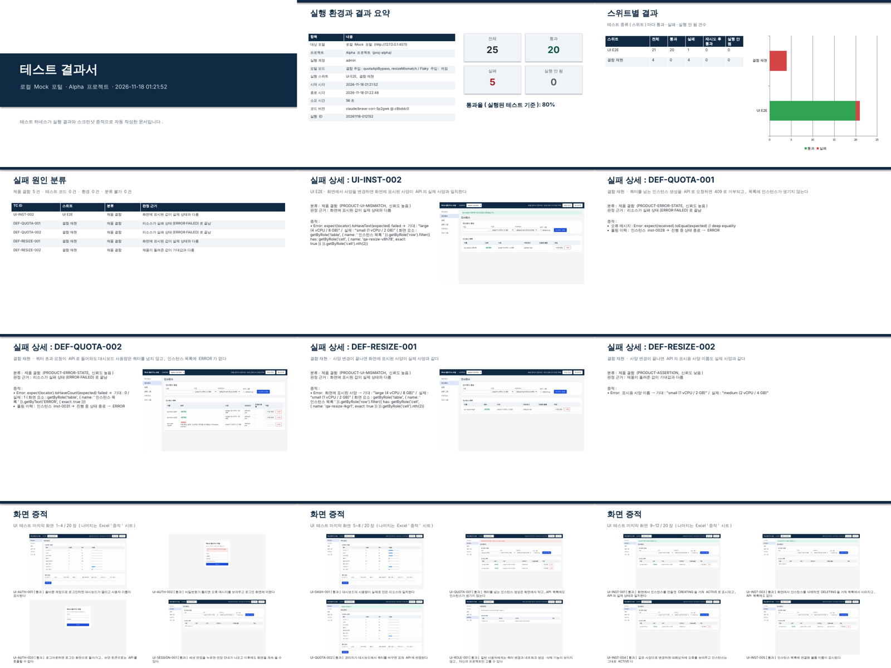

# 테스트 하네스, 결과서, 실패 원인 분류

[← README로 돌아가기](../README.md)

> 이 문서의 수치는 이 저장소에서 실제로 실행한 결과입니다. 시나리오와 데이터는 모두 가상입니다.

## 테스트 하네스와 결과서 자동 작성

테스트를 실행하고 끝나는 것이 아니라, **실행 → 증적 수집 → 실패 원인 분류 → 결과서 작성**까지 한 명령으로 이어지게 했습니다.

```bash
npm run harness                                               # 환경·프로젝트를 번호로 고른다(하나뿐이면 자동 선택)
npm run harness -- --env local --project proj-beta --suites api,ui
npm run harness -- --base-url http://127.0.0.1:4173           # 이미 떠 있는 포털을 대상으로 한다
```

### 하네스가 하는 일

| 순서 | 하는 일 | 코드 |
|---|---|---|
| 1. 포털 준비 | 대상 포털이 떠 있지 않으면 직접 띄우고, 상태 확인 API가 응답할 때까지 기다린다 | `harness/run.ts` |
| 2. 환경 선택 | 환경 목록(`GET /api/environments`)과 프로젝트 목록(`GET /api/projects`)을 API로 불러와 고른다. 옵션으로 정하거나, 터미널에서 번호로 고르거나, 하나뿐이면 자동으로 고른다. 포털 주소나 프로젝트 ID를 설정 파일에 직접 적지 않아도 된다 | `harness/run.ts` |
| 3. 테스트 실행 | 고른 대상(`BASE_URL`, `PROJECT_ID`)으로 스위트를 실행한다. 모든 UI 테스트의 마지막 화면을 스크린샷 증적으로 남긴다 | `playwright.config.ts` |
| 4. 증적 수집 | 테스트별 결과·소요 시간·오류와 스크린샷을 모으고, 스크린샷은 실행 디렉터리의 `evidence/`로 복사한다(`test-results/`는 다음 실행 때 지워지기 때문) | `harness/collect.ts` |
| 5. 실패 원인 분류 | 실패마다 규칙 기반으로 product / test / env를 판정한다 | `harness/triage/` |
| 6. 결과서 작성 | 실행 정보와 결과를 `report-data.json`으로 남기고, 이를 읽어 Excel·PPT 결과서를 만든다 | `harness/report/make_reports.py` |

결과는 `artifacts/harness/<실행 ID>/`에 모입니다: `test-report.xlsx`, `test-report.pptx`, `report-data.json`, `results.json`, `html-report/`, `evidence/`.

테스트가 프로젝트에 따라 달라지는 값(기본 네트워크, 다른 프로젝트의 리소스)은 하드코딩하지 않고 선택한 프로젝트에서 구합니다. 네거티브 dataset도 `{{project.network}}`, `{{other.sg}}` 같은 자리표시자를 씁니다. `proj-alpha`와 `proj-beta` 양쪽에서 API·UI·네거티브·결함 재현 테스트 106건이 모두 통과하는 것을 확인했습니다.

### 결과서 구성

| Excel 시트 | 내용 |
|---|---|
| 요약 | 대상 포털, 프로젝트, 계정, 포털 모드(결함·Flaky 주입 여부), 실행 시각, 코드 버전, 전체 통계(Not Run 포함), 스위트별 결과표와 차트, 실패 원인 분류 건수 |
| 테스트 결과 | 전체 테스트 목록(TC ID, 이름, 스위트, 결과, 소요 시간, 실패 원인 분류, 오류 메시지). 결과별 색, 필터, 틀 고정 |
| 실패 분석 | 실패마다 분류, 적용된 규칙, 신뢰도, 판정 근거, 증적 내용(기대값·실제값, 관련 요청, 폴링 이력) |
| 증적 | 스크린샷. 실패한 테스트를 먼저 두고 나머지는 실행 순서대로 |

PPT는 같은 내용을 표지 → 실행 환경과 결과 요약 → 스위트별 결과(차트) → 실패 원인 분류 → 실패 상세(한 건당 한 장, 판정 근거와 스크린샷) → 화면 증적(한 장에 4개) 순서로 담습니다. PPT의 화면 증적은 12장까지만 넣고, 나머지는 Excel '증적' 시트에 모두 들어갑니다.

예시 결과서는 결함 주입 모드(`DEFECT_QUOTA_API_BYPASS`, `DEFECT_RESIZE_MISMATCH`)에서 UI·결함 재현 스위트를 실행해 만든 것입니다(25건 중 실패 5건). [PPT 예시](samples/test-report-defect-mode.pptx), [Excel 예시](samples/test-report-defect-mode.xlsx)



### 결과서를 Python으로 만든 이유

테스트와 하네스는 TypeScript지만 결과서 생성만 Python(`openpyxl`, `python-pptx`)으로 작성했습니다. 두 라이브러리는 표, 차트, 이미지 삽입, 셀 병합, 인쇄 설정을 모두 지원하고 오래 쓰여 안정적이라서, 스크린샷 증적과 차트가 들어간 결과서를 Node 라이브러리보다 적은 코드로 만들 수 있습니다. 하네스와는 `report-data.json` 한 파일로만 연결되므로, 결과서 형식을 바꿔도 테스트 코드는 건드리지 않습니다.


## 실패 원인 자동 분류

테스트가 실패하면 원인이 제품 결함인지, 테스트 코드 문제인지, 실행 환경 문제인지부터 가려야 합니다. 이 판단을 사람이 증적을 하나씩 열어 보며 하지 않도록, 실패마다 증적을 남기고 규칙으로 먼저 분류합니다.

### 실패 증적

실패한 테스트에는 아래 증적이 Playwright 리포트에 첨부되고, 분류기는 JSON 결과에서 이 증적을 읽습니다.

| 증적 | 내용 | 남기는 곳 |
|---|---|---|
| `http-history.json` | 테스트 코드와 콘솔(브라우저)이 보낸 모든 API 요청의 응답 이력. 2xx 응답도 포함하고, 요청 주체(`api`/`browser`), 재전송 여부, 응답을 받지 못한 요청(`status: 0`)을 함께 남긴다 | `src/api/client.ts`, `src/flaky/network.ts` |
| `poll-history.json` | 상태 폴링에서 관측한 상태 변화(예: `CREATING → ERROR`) | `src/api/poll.ts` |
| `cause-log.json` | 테스트가 실행 중에 만난 문제와 원인 분류(env/product/test), 회복 여부 | `src/api/evidence.ts` |
| `flaky-events.json` | 포털이 실제로 주입한 지연·재전송·연결 끊김·토큰 교체 이력 | 포털 `GET /api/test/flaky-events` |
| 스크린샷, trace | 실패 시점 화면과 동작 기록 | Playwright 설정 |

### 분류 규칙

규칙은 `harness/triage/rules.ts`에 목록으로 관리합니다. 위에서부터 차례로 보고 처음 맞은 규칙으로 판정합니다. 환경(env) 규칙을 먼저 보는 이유는, 네트워크가 끊기면 화면 요소도 못 찾고 응답도 틀리게 보여서 뒤의 규칙들이 잘못 맞기 때문입니다.

| 규칙 | 분류 | 판정하는 상황 |
|---|---|---|
| `ENV-PORTAL-MODE` | env | 테스트가 기대한 포털 실행 모드(결함·Flaky 주입)와 실제 모드가 다름 |
| `ENV-PORTAL-DOWN` | env | 포털에 연결할 수 없음 |
| `ENV-NETWORK` | env | 응답을 받지 못한 네트워크 오류(연결 끊김). 화면 요소를 못 찾은 실패라도 그 사이 네트워크 오류가 있었으면 여기로 분류 |
| `ENV-AUTH-TOKEN` | env | 세션 연장이나 토큰 교체 뒤 401·403을 받음. 인증·권한을 검증하는 테스트(`@auth`, `@permission`)는 제외 |
| `TEST-DATASET` | test | dataset 형식 오류 |
| `TEST-CODE-ERROR` | test | 테스트 코드 실행 오류(TypeError 등) |
| `TEST-DATA-CONFLICT` | test | 테스트가 준비한 데이터가 기존 데이터와 이름이 겹침 |
| `TEST-RESPONSE-PAIRING` | test | 화면에 보이지 않는 재전송 요청의 4xx를 현재 단계의 결과로 해석함 |
| `TEST-FIXED-WAIT` | test | 고정 시간(`waitForTimeout`)을 기다린 뒤 바로 판정함 |
| `TEST-LOCATOR` | test | 화면 요소를 찾지 못함(없는 이름, 여러 개에 맞음) |
| `PRODUCT-ERROR-STATE` | product | 리소스가 ERROR·FAILED 상태로 끝남 |
| `PRODUCT-API-CONTRACT` | product | API 응답 코드·오류 코드가 입력 규칙과 다름 |
| `PRODUCT-UI-MISMATCH` | product | 화면 요소는 찾았지만 표시된 값이 기대와 다름 |
| `PRODUCT-ASSERTION` | product | 그 밖에 제품이 돌려준 값이 기대와 다름(넓은 규칙) |

- 판정 결과에는 판정 근거(기대값과 실제값, 관련 요청, 폴링 이력, 포털의 주입 이력)가 함께 남습니다.
- 다른 분류를 가리키는 규칙도 맞으면 **반대 증거**로 표시하고 신뢰도를 '낮음'으로 둡니다. 넓은 규칙(`PRODUCT-ASSERTION`)으로만 판정한 경우도 신뢰도 '낮음'입니다.
- `npm run triage`는 결과를 `artifacts/triage/triage.md`, `triage.json`으로 남기고, GitHub Actions에서는 Job Summary에도 씁니다.

### AI 실패 원인 추천(선택 기능)

`TRIAGE_AI=1 npm run triage`로 실행하면, 실패마다 증적(오류 메시지, 오류 위치 주변 코드, HTTP·폴링 이력, 원인 로그, 주입 이력)을 Claude API에 보내 원인 추천을 받습니다.

- 규칙 기반 판정을 대신하지 않고, 결과서에 **참고 의견** 열로만 붙습니다. 규칙 판정과 다르면 "(규칙과 다름)"으로 표시합니다.
- 공식 SDK(`@anthropic-ai/sdk`)의 구조화 출력(`output_config.format`, Zod 스키마)으로 `{ category, reason, nextAction }` 형식의 응답만 받습니다. 기본 모델은 `claude-opus-5-5`이고 `TRIAGE_AI_MODEL`로 바꿀 수 있습니다. 응답이 거절되면 서버가 다른 모델로 다시 실행하는 fallback 옵션을 켰습니다.
- 다음 조치로 판정 완화(assert 삭제, retry·timeout 증가, skip)를 제안하지 않도록 지시했습니다.
- 인증 정보가 없거나 호출이 실패하면 규칙 기반 결과만 남기고 "추천 없음"으로 표시합니다.

### 분류 정확도(이 저장소에서 실행한 결과)

`npm run triage:eval`은 정답(라벨)을 붙인 실패 시나리오(`tests/triage/labels.json`)를 실제로 실행해 실패를 만들고, 분류 결과를 정답과 비교합니다. 시나리오는 결함 주입 모드(product), 개선 전 Flaky 테스트(test·env), 일부러 실패하게 만든 샘플 테스트 6건(`tests/triage-samples`, `TRIAGE_SAMPLES=1`일 때만 실행)으로 구성했습니다.

조건: 라벨 17건, 실행일 2026-11-18

규칙 기반 분류 정확도: 16 / 17 (94.1%)

| 시나리오 | TC ID | 정답 | 규칙 판정 | 규칙 | 신뢰도 | 일치 |
|---|---|---|---|---|---|---|
| 결함: 쿼터 초과 API 우회 | DEF-QUOTA-001 | 제품 결함(product) | 제품 결함(product) | PRODUCT-ERROR-STATE | 높음 | O |
| 결함: 쿼터 초과 API 우회 | DEF-QUOTA-002 | 제품 결함(product) | 제품 결함(product) | PRODUCT-ERROR-STATE | 높음 | O |
| 결함: 쿼터 초과 API 우회 | NEG-INST-015 | 제품 결함(product) | 제품 결함(product) | PRODUCT-ERROR-STATE | 높음 | O |
| 결함: 쿼터 초과 API 우회 | NEG-INST-016 | 제품 결함(product) | 제품 결함(product) | PRODUCT-ERROR-STATE | 높음 | O |
| 결함: 사양 변경 후 표시 사양 불일치 | DEF-RESIZE-001 | 제품 결함(product) | 제품 결함(product) | PRODUCT-UI-MISMATCH | 높음 | O |
| 결함: 사양 변경 후 표시 사양 불일치 | DEF-RESIZE-002 | 제품 결함(product) | 제품 결함(product) | PRODUCT-ASSERTION | 낮음 | O |
| Flaky ①: 삭제 지연(개선 전 테스트) | FLAKY-DEL-001 | 테스트 코드(test) | 테스트 코드(test) | TEST-FIXED-WAIT | 높음 | O |
| Flaky ②: 응답 혼선(개선 전 테스트) | FLAKY-RESP-001 | 테스트 코드(test) | 테스트 코드(test) | TEST-RESPONSE-PAIRING | 높음 | O |
| Flaky ③: UI 반영 지연(개선 전 테스트) | FLAKY-UI-001 | 테스트 코드(test) | 테스트 코드(test) | TEST-FIXED-WAIT | 높음 | O |
| Flaky ④: 네트워크 끊김(개선 전 테스트) | FLAKY-NET-001 | 환경(env) | 환경(env) | ENV-NETWORK | 높음 | O |
| Flaky ④: 토큰 교체(개선 전 테스트) | FLAKY-TOKEN-001 | 환경(env) | 환경(env) | ENV-AUTH-TOKEN | 높음 | O |
| 분류기 검증 샘플 | TRIAGE-SAMPLE-001 | 테스트 코드(test) | 테스트 코드(test) | TEST-LOCATOR | 높음 | O |
| 분류기 검증 샘플 | TRIAGE-SAMPLE-002 | 테스트 코드(test) | 테스트 코드(test) | TEST-LOCATOR | 높음 | O |
| 분류기 검증 샘플 | TRIAGE-SAMPLE-003 | 테스트 코드(test) | 테스트 코드(test) | TEST-DATA-CONFLICT | 높음 | O |
| 분류기 검증 샘플 | TRIAGE-SAMPLE-004 | 테스트 코드(test) | 테스트 코드(test) | TEST-CODE-ERROR | 높음 | O |
| 분류기 검증 샘플 | TRIAGE-SAMPLE-005 | 환경(env) | 환경(env) | ENV-PORTAL-DOWN | 높음 | O |
| 분류기 검증 샘플 | TRIAGE-SAMPLE-006 | 테스트 코드(test) | 제품 결함(product) | PRODUCT-API-CONTRACT | 높음 | X |

분류별 결과(행: 정답, 열: 규칙 판정)

| 정답 \ 판정 | 제품 결함(product) | 테스트 코드(test) | 환경(env) | 분류 불가 |
|---|---|---|---|---|
| 제품 결함(product) | 6 | 0 | 0 | 0 |
| 테스트 코드(test) | 1 | 7 | 0 | 0 |
| 환경(env) | 0 | 0 | 3 | 0 |

**AI 추천 정확도는 측정하지 않았습니다.** 이 저장소를 개발한 환경에 Anthropic API 인증 정보가 없어 실제 호출을 하지 않았습니다. 인증 정보가 있는 환경에서 `TRIAGE_AI=1 npm run triage:eval`을 실행하면 같은 표에 AI 추천 정확도가 함께 계산됩니다.

#### 이 수치를 읽을 때 주의할 점

- **처음 측정에서는 17건 중 14건(82.4%)이었습니다.** 틀린 3건 중 2건(`DEF-QUOTA-002`, `DEF-RESIZE-001`)은 분류 규칙의 버그였습니다. Playwright는 locator로 값을 확인하는 모든 assertion의 호출 로그에 `waiting for getByRole(...)`을 남기는데, `TEST-LOCATOR` 규칙이 이 문구만 보고 "요소를 못 찾음"으로 판정했습니다. 실제로는 요소를 찾았고 값이 달랐습니다. 규칙을 "요소를 못 찾았다는 표시가 있고, 실제 받은 값이 없을 때"로 고친 뒤 다시 측정한 결과가 위 표입니다.
- 규칙을 고칠 때 본 데이터와 정확도를 잰 데이터가 같습니다. 그래서 94.1%는 새로운 실패에 대한 독립 검증 수치가 아니라, 이 라벨 세트에서의 결과입니다.
- `TRIAGE-SAMPLE-006`(API 규칙은 202인데 테스트가 201을 기대한 테스트 버그)은 일부러 넣은 한계 사례입니다. 증상만 보면 제품 결함과 똑같아서 규칙으로는 구분할 수 없고, 기대값이 요구사항과 맞는지 사람이 확인해야 합니다.
